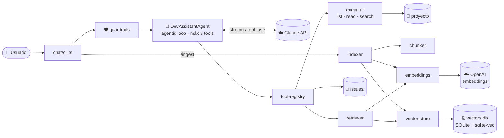

# 🤖 DevAssistant

[](https://codespaces.new/tu-usuario/dev-assistant)


> Agente de terminal que responde preguntas sobre **tu documentación** y **tu código**, citando la fuente. Construido con **Claude (Anthropic)**, **RAG** y **function calling**.

```text
Tú: ¿Cómo me autentico en la API?
Ejecutando tool: search_docs ({"query":"autenticación API"} [1/8])
DevAssistant: La API usa JWT. Haz POST /auth/login con email y password…
📎 Fuente: api-reference.md › ## Autenticación
```

DevAssistant indexa archivos Markdown en una base vectorial local (SQLite + `sqlite-vec`) y deja que Claude decida, en un *agentic loop*, qué herramientas usar: buscar en la documentación, listar, leer o buscar en el código, o registrar un issue. OpenAI se usa **solo** para generar los embeddings.

📘 **¿Quieres entender el proyecto a fondo?** Toda la documentación (arquitectura, diagramas UML, flujos, casos de uso, ficha de cada archivo…) está en [`docs/proyecto/`](docs/proyecto/README.md). Ver la [tabla de documentación](#-documentación).

---

## 📑 Contenido

- [Características](#-características)
- [Inicio rápido](#-inicio-rápido)
- [GitHub Codespaces](#️-github-codespaces)
- [Configuración](#️-configuración)
- [Uso](#-uso)
- [Herramientas del agente](#️-herramientas-del-agente)
- [Arquitectura](#️-arquitectura)
- [Estructura del proyecto](#-estructura-del-proyecto)
- [Tests y verificación](#-tests-y-verificación)
- [Documentación](#-documentación)
- [Solución de problemas](#-solución-de-problemas)

---

## ✨ Características

| | Característica | Detalle |
|---|---|---|
| 📚 | **RAG sobre Markdown** | Indexa los `.md` de una carpeta (con subcarpetas) y responde citando archivo y sección |
| 🤖 | **Agente autónomo** | Agentic loop con Claude: hasta 8 tool calls por turno, ejecutadas en paralelo |
| 🛠️ | **5 herramientas** | `search_docs`, `list_files`, `read_file`, `search_code`, `create_issue` |
| ⚡ | **Streaming real** | La respuesta aparece en tiempo real, con una sola llamada a la API por paso |
| 🛡️ | **Seguridad** | Detección de prompt injection (ES/EN), sanitización, rate limiting, sandbox de rutas y bloqueo de `.env` |
| 💰 | **Control de costos** | `/stats` muestra tokens y costo estimado en USD (chat + embeddings) |
| 🧪 | **Tests** | 41 tests con `node:test` que no llaman a ninguna API |
| 🗄️ | **Cero infraestructura** | La base vectorial es un único archivo SQLite local |

---

## 🚀 Inicio rápido

**Requisitos:** Node.js 18+ (probado con 22), npm 9+, una API key de [Anthropic](https://console.anthropic.com) (obligatoria) y otra de [OpenAI](https://platform.openai.com/api-keys) (para los embeddings del RAG).

```bash
# 1. Clonar e instalar
git clone https://github.com/DevTalles-corp/node-dev-assistant
cd node-dev-assistant
npm install

# 2. Configurar las API keys
cp .env.template .env        # edita ANTHROPIC_API_KEY y OPENAI_API_KEY

# 3. Comprobar que todo está bien (gratis, sin APIs)
npm run typecheck && npm test

# 4. Arrancar
npm run dev
```

Dentro de la CLI, carga la documentación de ejemplo y pregunta:

```text
Tú: /ingest
Tú: ¿Qué hago si recibo un error 429?
```

> ⚠️ Ejecuta siempre desde la **raíz del proyecto**: el agente solo puede ver archivos dentro del directorio desde el que arrancas.

Tutorial completo paso a paso: [Guía de uso](docs/proyecto/11-guia-de-uso.md).

---

## ☁️ GitHub Codespaces

Sin instalar nada: solo necesitas un navegador y una cuenta de GitHub.

1. En el repositorio: **Settings → Secrets and variables → Codespaces → New repository secret** y crea `ANTHROPIC_API_KEY` y `OPENAI_API_KEY`.
2. Pulsa el badge **Open in Codespaces** (o **Code → Codespaces → New codespace**).
3. Espera ~2 minutos: [`.devcontainer/devcontainer.json`](.devcontainer/devcontainer.json) ejecuta `npm install` y crea el `.env`.
4. `npm run dev`. Las keys llegan desde los Secrets; no hace falta editar `.env`.

---

## ⚙️ Configuración

Todas las variables se leen desde `.env` (plantilla comentada en [`.env.template`](.env.template)):

| Variable | Obligatoria | Por defecto | Descripción |
|---|---|---|---|
| `ANTHROPIC_API_KEY` | ✔ | — | Key de Claude. Sin ella la CLI no arranca |
| `OPENAI_API_KEY` | Para RAG | — | Solo para embeddings (`/ingest` y `search_docs`) |
| `ANTHROPIC_MODEL` | | `claude-sonnet-4-6` | Modelo de Claude para el agente |
| `OPENAI_EMBEDDING_MODEL` | | `text-embedding-3-small` | Modelo de embeddings. Si lo cambias, vuelve a ingestar |
| `EMBEDDING_DIMENSIONS` | | según el modelo | Solo para modelos de embeddings que DevAssistant no conoce |
| `DOCS_PATH` | | `./docs/sample-project` | Carpeta de `.md` a indexar (incluye subcarpetas) |
| `DB_PATH` | | `./data/vectors.db` | Archivo de la base vectorial |
| `RAG_TOP_K` | | `5` | Fragmentos recuperados por búsqueda |

> 🔐 Nunca subas `.env` al repositorio (está en `.gitignore`). El agente tampoco puede leerlo: `read_file` bloquea los archivos `.env*`.

Detalle de cada variable y de las constantes internas: [Configuración](docs/proyecto/07-configuracion.md).

---

## 💻 Uso

### Comandos npm

| Comando | Qué hace | Usa APIs de pago |
|---|---|---|
| `npm run dev` / `npm start` | CLI interactiva con el agente | Sí |
| `npm run ingest` | Indexa `DOCS_PATH` y genera `data/chunks-preview.json` | Sí (OpenAI) |
| `npm run demo` | Demo automática de 4 escenarios (crea un issue en `issues/`) | Sí |
| `npm run review <archivo>` | Code review de un archivo con Claude, en streaming | Sí |
| `npm test` | 41 tests | **No** |
| `npm run typecheck` | Typecheck de `src/` y `tests/` | **No** |
| `npm run build` | Compila a `dist/` | **No** |
| `npx tsx src/security/examples.ts` | Demo de los guardrails | **No** |

### Comandos dentro de la CLI

| Comando | Qué hace |
|---|---|
| `/ingest [ruta]` | Indexa los `.md` de `ruta` (o `DOCS_PATH`). Reemplaza el índice anterior |
| `/stats` | Turnos, tokens (Claude + embeddings) y costo estimado de la sesión |
| `/tools` | Lista las herramientas del agente y sus parámetros |
| `/clear` | Empieza una conversación nueva (el costo de la sesión se conserva) |
| `/exit` | Sale y muestra el resumen |

Cualquier otro texto pasa por los guardrails y se envía al agente.

### Ejemplos de preguntas

```text
# Sobre la documentación (search_docs)
¿Cómo renuevo el token de acceso?
¿Qué eventos de webhook existen y cómo verifico la firma?

# Sobre el código (list_files, read_file, search_code)
¿Dónde se usa retrieveContext?
Explícame cómo funciona src/rag/chunker.ts

# Acciones (create_issue)
Crea un issue: la búsqueda no encuentra sinónimos. Etiquetas: rag. Prioridad: medium.
```

### Usar tu propia documentación

```text
Tú: /ingest ./docs/mi-proyecto
```

O fija `DOCS_PATH=./docs/mi-proyecto` en `.env` y ejecuta `npm run ingest`. Más opciones (incluido usar el agente sobre otro repositorio) en la [Guía de uso](docs/proyecto/11-guia-de-uso.md), sección 8.

---

## 🛠️ Herramientas del agente

| Tool | Qué hace | Efecto |
|---|---|---|
| `search_docs` | Búsqueda semántica en la documentación indexada (top-K, máx. 10) | Lectura + OpenAI |
| `list_files` | Lista archivos de un directorio del proyecto (omite ocultos y `node_modules`) | Lectura |
| `read_file` | Lee un archivo (máx. 50 KB; nunca `.env`) | Lectura |
| `search_code` | Busca un texto literal (máx. 20 coincidencias, ±2 líneas de contexto) | Lectura |
| `create_issue` | Crea `issues/issue-NNN.md` con título, descripción, etiquetas y prioridad | **Escribe** en disco |

Todas las rutas quedan confinadas al directorio del proyecto, también a través de enlaces simbólicos. Esquemas, ejemplos y cómo añadir una tool nueva: [Funciones y tools](docs/proyecto/06-funciones-tools.md).

---

## 🏗️ Arquitectura



**Ingesta:** los `.md` se dividen en chunks por encabezados `##` (máx. 2000 caracteres, con solapamiento de un párrafo), se embeben con OpenAI en lotes de 100 y se guardan en SQLite.

**Consulta:** el agente envía a Claude el historial y las 5 tools. Si Claude pide una tool, se ejecuta y su resultado vuelve a Claude. El ciclo se repite hasta que responde (`end_turn`) o hasta llegar a 8 tool calls.

Para más detalle:
- [Arquitectura](docs/proyecto/03-arquitectura.md): capas, grafo de dependencias, decisiones de diseño y stack.
- [Flujos](docs/proyecto/04-flujos.md): diagramas de secuencia de cada operación.
- [Modelo de datos](docs/proyecto/05-modelo-datos.md): diagrama de clases UML y esquema de la base de datos.

---

## 📁 Estructura del proyecto

```text
├── src/
│   ├── index.ts              # Entry point de la CLI (valida la config y arranca)
│   ├── config.ts             # Configuración tipada desde .env
│   ├── interface.ts · types.ts
│   ├── agent/                # DevAssistantAgent, system prompt, registro de tools, demo
│   ├── chat/                 # CLI interactiva (+ Conversation, chat simple sin tools)
│   ├── rag/                  # indexer, chunker, embeddings, vector-store, retriever, ingest, rag-chain
│   ├── tools/                # Tools de archivos: definiciones, executor con sandbox, loop simple
│   ├── llm/                  # Cliente Anthropic, streaming, prompts reutilizables
│   ├── security/             # Guardrails y ejemplos
│   ├── utils/                # Calculadora de costos
│   └── exercises/            # Code reviewer
├── tests/                    # 41 tests (node:test + tsx)
├── docs/
│   ├── proyecto/             # 📘 Documentación completa del proyecto
│   ├── sample-project/       # Corpus de ejemplo para el RAG (API ficticia TaskFlow)
│   └── config-model/         # Diagramas de referencia del curso (PNG)
├── .devcontainer/            # Configuración de GitHub Codespaces
├── data/                     # vectors.db (generado)
└── issues/                   # Issues creados por el agente (generado)
```

Qué hace cada archivo, qué exporta, de qué depende y si es reutilizable: [Catálogo de archivos](docs/proyecto/09-catalogo-archivos.md).

---

## 🧪 Tests y verificación

```bash
npm test                                              # todos los tests
npx tsx --test tests/chunker.test.ts                  # un archivo
npx tsx --test --test-name-pattern "rate limiter" tests/guardrails.test.ts   # un test
npm run typecheck
```

| Archivo | Cubre |
|---|---|
| `tests/chunker.test.ts` | División por encabezados, solapamiento, CRLF, subcarpetas, ids únicos |
| `tests/vector-store.test.ts` | Búsqueda por similitud y cambio de dimensión de los embeddings |
| `tests/guardrails.test.ts` | Sanitización, prompt injection (bloqueados y legítimos), rate limit |
| `tests/cost-calculator.test.ts` | Cálculo y formato de costos |
| `tests/tools.test.ts` | Sandbox, bloqueo de `.env`, symlinks, `list_files`, `search_code`, `create_issue` |

Ningún test llama a APIs externas.

---

## 📘 Documentación

La carpeta [`docs/proyecto/`](docs/proyecto/README.md) explica el proyecto completo. También hay una versión navegable en el navegador: abre [`docs/proyecto/index.html`](docs/proyecto/index.html) con doble clic.

| Si quieres… | Lee |
|---|---|
| Entender qué es y para qué sirve | [01 · Visión de negocio](docs/proyecto/01-vision-negocio.md) · [02 · Idea del asistente](docs/proyecto/02-idea-asistente.md) |
| Ver cómo está construido | [03 · Arquitectura](docs/proyecto/03-arquitectura.md) · [04 · Flujos](docs/proyecto/04-flujos.md) · [05 · Modelo de datos](docs/proyecto/05-modelo-datos.md) |
| Saber qué puede hacer el agente | [06 · Funciones y tools](docs/proyecto/06-funciones-tools.md) · [10 · Casos de uso](docs/proyecto/10-casos-de-uso.md) |
| Configurarlo y usarlo | [07 · Configuración](docs/proyecto/07-configuracion.md) · [11 · Guía de uso](docs/proyecto/11-guia-de-uso.md) |
| Saber qué hace cada archivo | [09 · Catálogo de archivos](docs/proyecto/09-catalogo-archivos.md) |
| Reutilizar piezas en otro proyecto | [12 · Módulos reutilizables](docs/proyecto/12-reutilizables.md) |
| Revisar la seguridad | [13 · Seguridad](docs/proyecto/13-seguridad.md) |
| Conocer bugs, deuda técnica y próximos pasos | [14 · Problemas conocidos](docs/proyecto/14-problemas-conocidos.md) · [08 · Roadmap](docs/proyecto/08-roadmap.md) |
| Consultar un término (RAG, embedding, tool use…) | [15 · Glosario](docs/proyecto/15-glosario.md) |

---

## 🩺 Solución de problemas

| Síntoma | Solución |
|---|---|
| `ANTHROPIC_API_KEY está vacía` al arrancar | `cp .env.template .env` y añade tu key |
| `No se encontraron documentos relevantes… /ingest` | Ejecuta `/ingest` antes de preguntar sobre la documentación |
| `El vector tiene N dimensiones pero la base usa M` | Cambiaste el modelo de embeddings: vuelve a ejecutar `/ingest` |
| `Tu mensaje contiene patrones…` | Un guardrail detectó un posible prompt injection; reformula la pregunta |
| `He alcanzado el límite de 8 llamadas…` | Divide la tarea en preguntas más pequeñas |

Más casos en la [Guía de uso](docs/proyecto/11-guia-de-uso.md#-solución-de-problemas).

---

## 📄 Licencia

MIT
