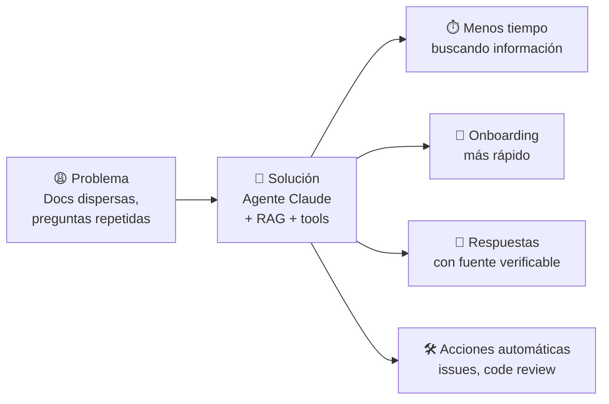

# 01 · Visión de negocio

> **Propósito de esta sección:** explicar por qué existe el proyecto, a quién sirve y cómo sabremos que funciona.

## 🎯 Problema

En los equipos de desarrollo la documentación técnica (READMEs, referencias de API, guías de instalación, decisiones de arquitectura) suele estar:

- **Dispersa** en muchos archivos y repositorios.
- **Desactualizada** o difícil de buscar con palabras clave exactas.
- **Costosa de consultar**: los devs nuevos interrumpen a los senior con preguntas repetidas.

Además, para entender **el código** hay que abrir muchos archivos y buscar dónde se usa cada cosa.

Resultado: onboarding lento, conocimiento concentrado en pocas personas y tiempo perdido buscando información.

## 💡 Solución

**DevAssistant**: un asistente conversacional de terminal que:

1. **Lee la documentación** del proyecto (RAG) y responde en lenguaje natural **citando archivo y sección**.
2. **Explora el código** por sí mismo (listar, leer y buscar archivos) para responder preguntas sobre el codebase.
3. **Ejecuta acciones**: registra issues en `./issues/` y, como ejercicio aparte, hace **code review** de un archivo.

## 👥 Usuarios (personas)

| Persona | Necesidad | Cómo le ayuda DevAssistant |
|---|---|---|
| **Dev nuevo** (onboarding) | Entender rápido cómo instalar, configurar y usar la API | Responde "¿cómo me autentico?" con el fragmento exacto de la doc |
| **Dev senior** | Dejar de responder las mismas preguntas | Delega preguntas frecuentes al asistente |
| **Tech lead** | Mantener calidad y trazabilidad | Code review asistido y creación de issues estructurados |
| **Estudiante del curso** | Aprender RAG, tool use y agentes con un proyecto real | Cada módulo implementa una técnica aislada y reutilizable |

## 🧩 Casos de uso principales

Especificación completa (actores, flujos, pre/postcondiciones) en [10 · Casos de uso](10-casos-de-uso.md).

| ID | Caso de uso | Cómo se usa | Estado |
|---|---|---|---|
| CU-01 | Conversar con el agente | `npm run dev` | ✅ |
| CU-02 | Indexar documentación | `/ingest [ruta]` o `npm run ingest` | ✅ |
| CU-03 | Preguntar sobre la documentación (RAG) | Pregunta en la CLI → tool `search_docs` | ✅ |
| CU-04 | Explorar el código del proyecto | Pregunta en la CLI → tools `list_files` / `read_file` / `search_code` | ✅ |
| CU-05 | Crear un issue | Pídeselo al agente → tool `create_issue` | ✅ |
| CU-06 | Ver consumo y costo | `/stats` y al salir con `/exit` | ✅ |
| CU-07 | Reiniciar la conversación | `/clear` | ✅ |
| CU-08 | Code review de un archivo | `npm run review <archivo>` | ✅ |
| CU-09 | Ver la demo automática | `npm run demo` | ✅ |
| CU-10 | Probar los guardrails | `npx tsx src/security/examples.ts` | ✅ |
| CU-11 | Listar las tools | `/tools` | ✅ |

Corpus de ejemplo: documentación ficticia de **TaskFlow API** en [`../sample-project/`](../sample-project/).

## 📈 Métricas de éxito

| Métrica | Cómo se mide | Meta inicial |
|---|---|---|
| Precisión de respuestas | % de respuestas correctas en un set de preguntas de prueba | ≥ 80 % |
| Respuestas con fuente | % de respuestas sobre docs que citan archivo y sección | 100 % |
| Tiempo de respuesta | Latencia promedio por pregunta | < 10 s |
| Costo por sesión | `/stats` (tokens × precio de `cost-calculator.ts`) | Monitoreado |
| Seguridad | Intentos de prompt injection bloqueados (`security/examples.ts`) | 100 % de los casos de ejemplo |

## 📦 Alcance

**Dentro del alcance**
- Asistente por línea de comandos (CLI).
- Documentación en Markdown local (un directorio y sus subcarpetas).
- Un solo LLM para el chat (Claude); OpenAI solo para embeddings.
- Exploración de código **solo dentro del directorio del proyecto** (sandbox).
- Issues locales como archivos Markdown.

**Fuera del alcance (por ahora)**
- Interfaz web / chat en Slack.
- Autenticación de usuarios y multi-tenant.
- Indexar fuentes remotas (Confluence, Notion, etc.).
- Sincronizar issues con GitHub/Jira.
- Memoria persistente entre sesiones.

---

> 📝 **Plantilla — preguntas a responder en tu proyecto**
> 1. ¿Qué problema concreto existe hoy y quién lo sufre?
> 2. ¿Cuál es la solución en una frase?
> 3. ¿Quiénes son los 2–4 tipos de usuario y qué necesita cada uno?
> 4. ¿Cuáles son los casos de uso principales y su estado?
> 5. ¿Con qué métricas sabrás que funciona?
> 6. ¿Qué queda explícitamente fuera del alcance?
