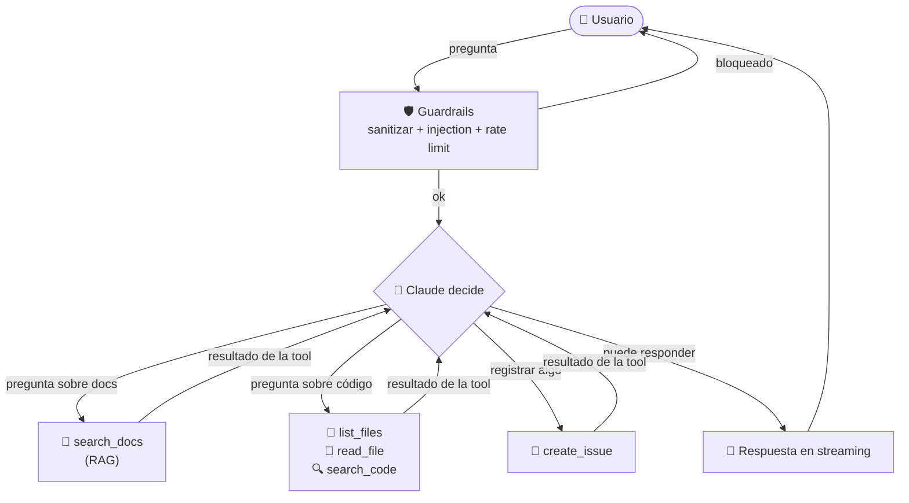

# 02 · Idea del asistente

> **Propósito de esta sección:** describir el producto desde la perspectiva del usuario: qué sabe hacer, cómo se comporta y cuáles son sus límites.

## 🤖 ¿Qué es DevAssistant?

Un **agente conversacional de terminal** que combina tres técnicas:

| Técnica | Para qué sirve en DevAssistant | Dónde vive |
|---|---|---|
| **LLM (Claude)** | Entender la pregunta, decidir qué herramienta usar y redactar la respuesta. Es el **único** LLM de chat; OpenAI solo genera embeddings | `src/agent/agent.ts`, `src/llm/` |
| **RAG** (Retrieval-Augmented Generation) | Buscar los fragmentos relevantes de la documentación y dárselos al modelo como contexto para que no invente | `src/rag/` |
| **Function calling** (tool use) | Permitir que el modelo pida ejecutar funciones reales: leer/buscar archivos, buscar en docs, crear issues | `src/tools/`, `src/agent/tool-registry.ts` |

Un **agente** se diferencia de un chatbot en que **decide por sí mismo** qué acciones ejecutar, observa los resultados y vuelve a decidir, en un bucle (*agentic loop*), hasta tener la respuesta.

## 🧠 Capacidades



| Capacidad | Descripción | Estado |
|---|---|---|
| Q&A sobre documentación | `search_docs` recupera los chunks más parecidos de la base vectorial | ✅ |
| Citar fuentes | Cada fragmento llega al modelo como `[FUENTE: archivo \| Sección: … \| Relevancia: …%]`, y el system prompt le pide citarlo | ✅ |
| Explorar código | `list_files`, `read_file`, `search_code` (solo dentro del proyecto) | ✅ |
| Encadenar herramientas | Hasta **8 tool calls por turno**, varias en paralelo | ✅ |
| Crear issues | Escribe `issues/issue-NNN.md` con metadata | ✅ |
| Respuesta en streaming | El texto aparece en tiempo real en la terminal (una sola llamada por paso del loop) | ✅ |
| Memoria de la conversación | El historial se mantiene durante la sesión (`/clear` lo borra) | ✅ |
| Reporte de consumo | `/stats`: turnos, tokens de Claude y de embeddings, y costo estimado en USD | ✅ |
| Code review | Script aparte `npm run review <archivo>` | ✅ |
| Guardrails | Bloquea prompt injection (EN/ES) y exceso de peticiones | ✅ |
| Proteger secretos | `read_file` no puede leer `.env`; el sandbox resuelve symlinks | ✅ |

## 💬 Ejemplo de conversación real

```text
Tú: /ingest
Iniciando ingestión desde: ./docs/sample-project
Procesando api-reference.md... 11 chunks generados
Procesando getting-started.md... 7 chunks generados
Procesando README.md... 12 chunks generados
Generando embeddings para 30 chunks...
30 chunks almacenados en ./data/vectors.db
Vector store actualizado — listo para búsquedas

Tú: ¿Cómo me autentico en la API de TaskFlow?
Agente procesando turno 1...
Ejecutando tool: search_docs ({"query":"autenticación API TaskFlow"} [1/8])
Buscando: "autenticación API TaskFlow" -> 5 chunks recuperados
Herramienta completada: search_docs
DevAssistant: TaskFlow usa **JWT**. Haz `POST /auth/login` con email y password…
📎 Fuente: api-reference.md › ## Autenticación

Herramientas utilizadas: search_docs

Tú: Crea un issue para documentar mejor el refresh token, prioridad alta
Ejecutando tool: create_issue (...)
DevAssistant: ✅ Issue creado: issues/issue-001.md
```

## 🎭 Personalidad y reglas (system prompt real)

El system prompt está en [`src/agent/system-prompt.ts`](../../src/agent/system-prompt.ts) (`AGENT_SYSTEM_PROMPT`). Resumen:

- **Rol:** agente de asistencia técnica especializado en documentación y análisis de código.
- **Conoce sus 5 tools** y tiene **reglas de decisión** explícitas:
  - Preguntas "¿cómo…?", "¿qué es…?" → `search_docs` (siempre antes de decir que no sabe).
  - "¿Dónde se usa X?" → `search_code`; "lee este archivo" → `read_file`; si no conoce la estructura → `list_files` primero.
  - Solo crea issues si el usuario lo pide explícitamente.
- **Formato:** Markdown, conciso, cita archivo y sección, incluye rutas de código.
- **Límites:** máximo 8 tool calls por turno, solo archivos del proyecto, sin internet, issues solo locales.

## 🚧 Limitaciones conocidas

- Solo conoce lo que está indexado; si la doc está desactualizada, la respuesta también. Hay que repetir `/ingest` tras cambiar los `.md`.
- Cada `/ingest` **reemplaza** el índice: solo hay una colección de documentos a la vez.
- La calidad depende del *chunking* (división por `## `, máx. 2000 caracteres) y de `RAG_TOP_K`.
- Cada respuesta cuesta tokens; las preguntas muy amplias usan más contexto (cada paso del loop reenvía el historial completo).
- Sin memoria persistente entre sesiones.
- Los guardrails se basan en **expresiones regulares**: son una primera barrera, no una garantía.

---

> 📝 **Plantilla — preguntas a responder en tu proyecto**
> 1. ¿Qué es el producto en una frase y qué técnicas usa?
> 2. ¿Cuáles son sus capacidades y en qué estado está cada una?
> 3. ¿Cómo se ve una interacción típica (ejemplo real)?
> 4. ¿Qué reglas de comportamiento debe respetar siempre?
> 5. ¿Cuáles son sus límites conocidos?
