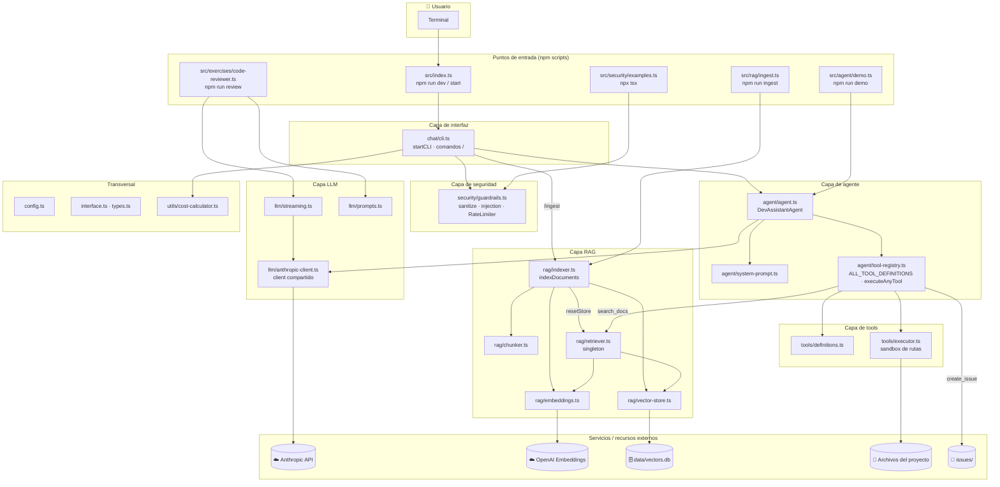
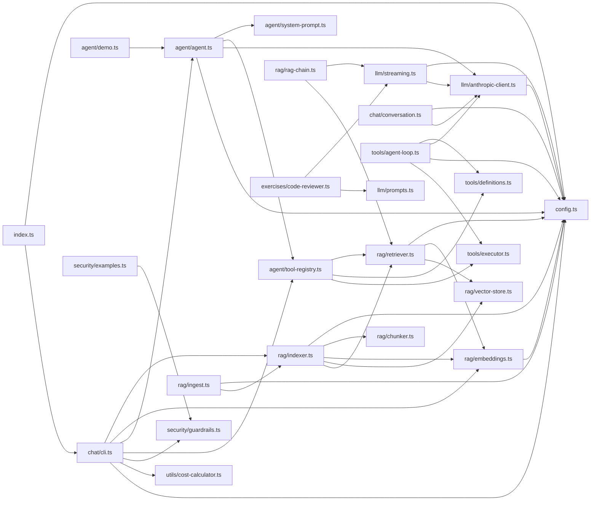

# 03 · Arquitectura

> **Propósito de esta sección:** mostrar las piezas del sistema, cómo se agrupan en capas y cómo dependen unas de otras.

## 🏗️ Diagrama de componentes



## 🧱 Capas y responsabilidades

| Capa | Archivos | Responsabilidad | Depende de |
|---|---|---|---|
| **Entrada** | `index.ts`, `rag/ingest.ts`, `agent/demo.ts`, `exercises/code-reviewer.ts`, `security/examples.ts` | Arrancar un programa concreto (cada uno es un "main") | Las capas inferiores |
| **Interfaz** | `chat/cli.ts` | Leer la entrada, enrutar comandos `/`, imprimir respuestas y estadísticas | Seguridad, Agente, RAG, Utils |
| **Seguridad** | `security/guardrails.ts` | Sanitizar texto, detectar prompt injection, limitar peticiones | — (sin dependencias) |
| **Agente** | `agent/agent.ts`, `agent/system-prompt.ts`, `agent/tool-registry.ts` | Agentic loop con Claude; registro y despacho de las 5 tools | LLM, Tools, RAG |
| **Tools** | `tools/definitions.ts`, `tools/executor.ts` | Esquemas JSON de las tools de archivos y su ejecución segura | Sistema de archivos |
| **RAG** | `rag/indexer.ts`, `rag/chunker.ts`, `rag/embeddings.ts`, `rag/vector-store.ts`, `rag/retriever.ts`, `rag/rag-chain.ts` | Pipeline de ingesta, dividir docs, generar embeddings, almacenar y buscar vectores | OpenAI, SQLite, (LLM para `rag-chain`) |
| **LLM** | `llm/anthropic-client.ts`, `llm/streaming.ts`, `llm/prompts.ts` | Cliente único de Anthropic, helpers de llamada/streaming, prompts | Anthropic API |
| **Transversal** | `config.ts`, `interface.ts`, `types.ts`, `utils/cost-calculator.ts` | Configuración, tipos compartidos, cálculo de costos | `.env` |

Módulos **históricos del curso** que siguen en el código pero que la CLI no usa (útiles como ejemplo o para reutilizar): `chat/conversation.ts` (chat simple sin tools), `tools/agent-loop.ts` (loop de tools mínimo), `rag/rag-chain.ts` (RAG directo sin agente), `llm/anthropic-client.ts#askClaude`.

## 🔗 Grafo de dependencias entre módulos (imports)



> `interface.ts` y `types.ts` se importan desde casi todos los módulos; se omiten del grafo para que sea legible.

## 🧩 Decisiones de diseño clave

| Decisión | Por qué | Consecuencia |
|---|---|---|
| **Un solo cliente de Anthropic** exportado desde `llm/anthropic-client.ts` | Reutilizar conexión y configuración | Todos los módulos importan `client` de ahí |
| **Embeddings con OpenAI, chat con Claude** | Anthropic no ofrece API de embeddings propia | Se necesitan **dos API keys** para el flujo completo |
| **SQLite + `sqlite-vec`** como base vectorial | Cero infraestructura: un archivo local | La dimensión del vector se fija al crear la tabla y se guarda en `meta`; cambiar de modelo exige re-ingestar |
| **Store del retriever como singleton** | No reabrir la BD en cada búsqueda | `indexDocuments()` llama a `resetStore()` antes de reescribir la base |
| **Una sola implementación de la ingesta** (`rag/indexer.ts`) | La CLI y el script no deben divergir | `ingest.ts` es solo un envoltorio de línea de comandos |
| **Streaming dentro del loop** (`messages.stream` + `finalMessage()`) | Ver el texto en tiempo real sin pagar una llamada extra | El texto que Claude escribe antes de pedir una tool también se muestra |
| **Tools que devuelven `string`** (también en error) | El modelo puede leer el error y corregirse | Los errores de tools nunca lanzan excepción al loop |
| **Sandbox de rutas** con `process.cwd()` + `realpath` + bloqueo de `.env` | Impedir que el modelo lea fuera del proyecto o lea secretos | Hay que ejecutar la CLI **desde la raíz del proyecto** |
| **Límite de 8 tool calls por turno** | Evitar bucles infinitos y costos descontrolados | Tareas grandes deben dividirse |
| **Guardrails antes del agente** | Rechazar entradas maliciosas sin gastar tokens | Los comandos `/` no pasan por guardrails |

## 🔀 Proveedores

| Proveedor | Para qué | Dónde |
|---|---|---|
| **Anthropic (Claude)** | Todo el chat: agente, streaming, code review, `Conversation`, `askWithRAG` | `llm/anthropic-client.ts` |
| **OpenAI** | **Solo** embeddings (ingesta y `search_docs`) | `rag/embeddings.ts` |

Antes existían las variables `MODEL_PROVIDER` y `OPENAI_MODEL`, pero ningún flujo las usaba; se **eliminaron** para que la configuración refleje lo que el código hace de verdad. Si en el futuro se quiere OpenAI como LLM del chat, el punto de extensión natural es un `llm/openai-client.ts` más una capa que traduzca el formato de tools y mensajes (`tool_use`/`tool_result` de Anthropic ↔ `tool_calls` de OpenAI).

## 🧰 Stack tecnológico

| Paquete | Versión | Uso |
|---|---|---|
| `typescript` | ^5.9 | Lenguaje y `tsc` (typecheck/build) |
| `tsx` | ^4.21 | Ejecuta `.ts` directamente sin compilar |
| `@anthropic-ai/sdk` | ^0.80 | Llamadas a Claude (`messages.create`, `messages.stream`) |
| `openai` | ^6.32 | Embeddings (`embeddings.create`) |
| `better-sqlite3` | ^13.2 | Driver SQLite síncrono |
| `sqlite-vec` | ^0.1.9 | Extensión de búsqueda vectorial (`vec0`, `MATCH`, `k`) |
| `dotenv` | ^17.3 | Carga `.env` en `process.env` |
| `node:test` (nativo) | — | Runner de tests, ejecutado con `tsx --test` (sin dependencias extra) |
| `@types/node`, `@types/better-sqlite3` | dev | Tipos |

## 📁 Estructura de carpetas

```text
DEV-ASSITANT/
├── src/                      # Código fuente (ver 09-catalogo-archivos.md)
│   ├── index.ts              # Entry point de la CLI
│   ├── config.ts             # Configuración desde .env
│   ├── interface.ts          # Interfaces compartidas
│   ├── types.ts              # Tipos unión compartidos
│   ├── agent/                # Agente, system prompt, registro de tools, demo
│   ├── chat/                 # CLI interactiva + clase Conversation (histórica)
│   ├── exercises/            # Ejercicio: code reviewer
│   ├── llm/                  # Cliente Anthropic, streaming, prompts
│   ├── rag/                  # Indexer, chunking, embeddings, vector store, retriever, ingest
│   ├── security/             # Guardrails y ejemplos
│   ├── tools/                # Tools de archivos: definiciones, executor, loop simple
│   └── utils/                # Calculadora de costos
├── tests/                    # Tests (node:test) + tsconfig.json para su typecheck
├── docs/
│   ├── proyecto/             # ← Esta documentación
│   ├── sample-project/       # Corpus RAG de ejemplo (TaskFlow API)
│   └── config-model/         # Diagramas de referencia (PNG)
├── data/                     # vectors.db (+ -wal/-shm) y chunks-preview.json  [generado, gitignored]
├── issues/                   # Issues creados por el agente                     [generado, gitignored]
├── .devcontainer/            # devcontainer.json para GitHub Codespaces
├── .github/codespaces/       # post-create.sh (lo ejecuta el devcontainer)
├── .env / .env.template      # Variables de entorno
├── package.json · tsconfig.json
├── README.md                 # README general del repositorio
└── CLAUDE.md                 # Guía para Claude Code
```

---

> 📝 **Plantilla — preguntas a responder en tu proyecto**
> 1. ¿Cuáles son los componentes y cómo se agrupan en capas?
> 2. ¿Qué depende de qué (grafo de imports)?
> 3. ¿Qué decisiones de diseño se tomaron y por qué?
> 4. ¿Qué stack se usa y para qué sirve cada dependencia?
> 5. ¿Cómo está organizada la estructura de carpetas?
