# 04 · Flujos

> **Propósito de esta sección:** describir paso a paso qué ocurre en cada operación, con diagramas de secuencia y de actividad.

Índice:
1. [Arranque de la CLI](#1-arranque-de-la-cli-)
2. [Bucle de la CLI y enrutado de comandos](#2-bucle-de-la-cli-y-enrutado-de-comandos-)
3. [Ingesta de documentación (`/ingest` y `npm run ingest`)](#3-ingesta-de-documentación-)
4. [Un turno del agente (agentic loop)](#4-un-turno-del-agente-agentic-loop-)
5. [Tool `search_docs` (consulta RAG)](#5-tool-search_docs-consulta-rag-)
6. [Tools de archivos con sandbox](#6-tools-de-archivos-con-sandbox-)
7. [Tool `create_issue`](#7-tool-create_issue-)
8. [Code review (`npm run review`)](#8-code-review-npm-run-review-)
9. [Demo automática (`npm run demo`)](#9-demo-automática-npm-run-demo-)
10. [RAG directo sin agente (`askWithRAG`)](#10-rag-directo-sin-agente-askwithrag-)

---

## 1. Arranque de la CLI ✅

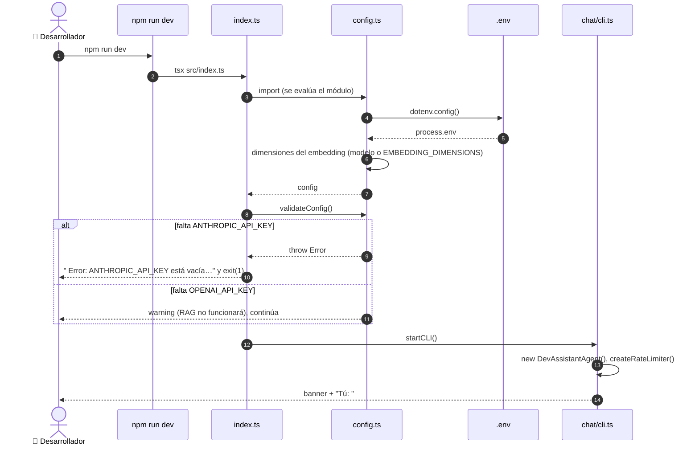

> Importante: al **importar** `config.ts`, `llm/anthropic-client.ts` y `rag/embeddings.ts` se crean los clientes de Anthropic y OpenAI con las keys del `.env` (efecto secundario de import).

## 2. Bucle de la CLI y enrutado de comandos ✅

`startCLI()` lee las líneas con `for await (const line of rl)` y delega cada una en `handleInput()`. Mientras el agente responde, las líneas nuevas esperan en cola.

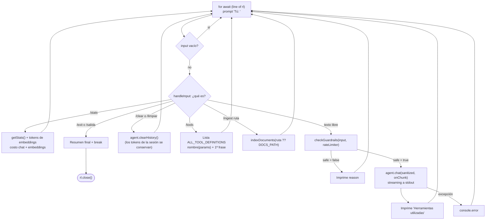

## 3. Ingesta de documentación ✅

Una sola implementación: `indexDocuments()` en `rag/indexer.ts`, usada por el comando `/ingest` de la CLI y por `npm run ingest` (`rag/ingest.ts`, que además pide escribir `data/chunks-preview.json`).

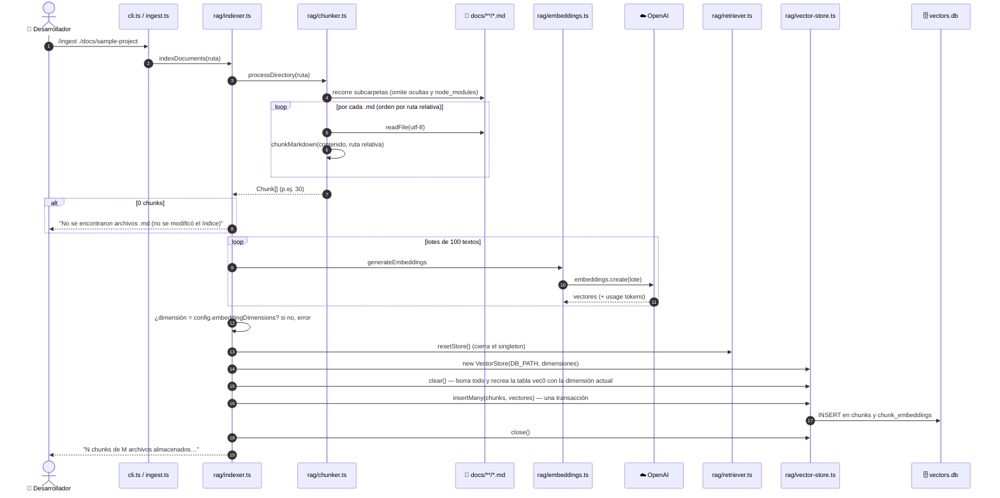

### Algoritmo de chunking (`chunkMarkdown`)

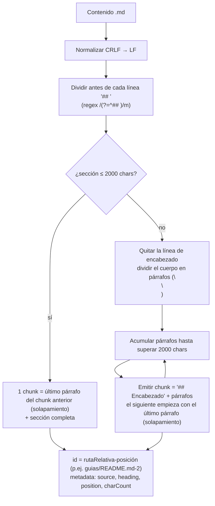

- El texto antes del primer `## ` se etiqueta como `heading: "(Introducción)"`.
- El solapamiento de **un párrafo** entre chunks consecutivos mantiene el contexto entre fragmentos.
- Los encabezados `###` no dividen; quedan dentro del chunk de su `##`.
- `source` es la ruta relativa al directorio ingestado, con `/` como separador; así dos `README.md` en carpetas distintas no colisionan.

## 4. Un turno del agente (agentic loop) ✅

`DevAssistantAgent.chat(userMessage, onChunk?)` en `src/agent/agent.ts`. Cada iteración hace **una sola llamada** a través de `callModel()`: con `onChunk` usa `messages.stream` (el texto se emite en tiempo real) y `finalMessage()` para leer `stop_reason` y `usage`; sin `onChunk` usa `messages.create`.

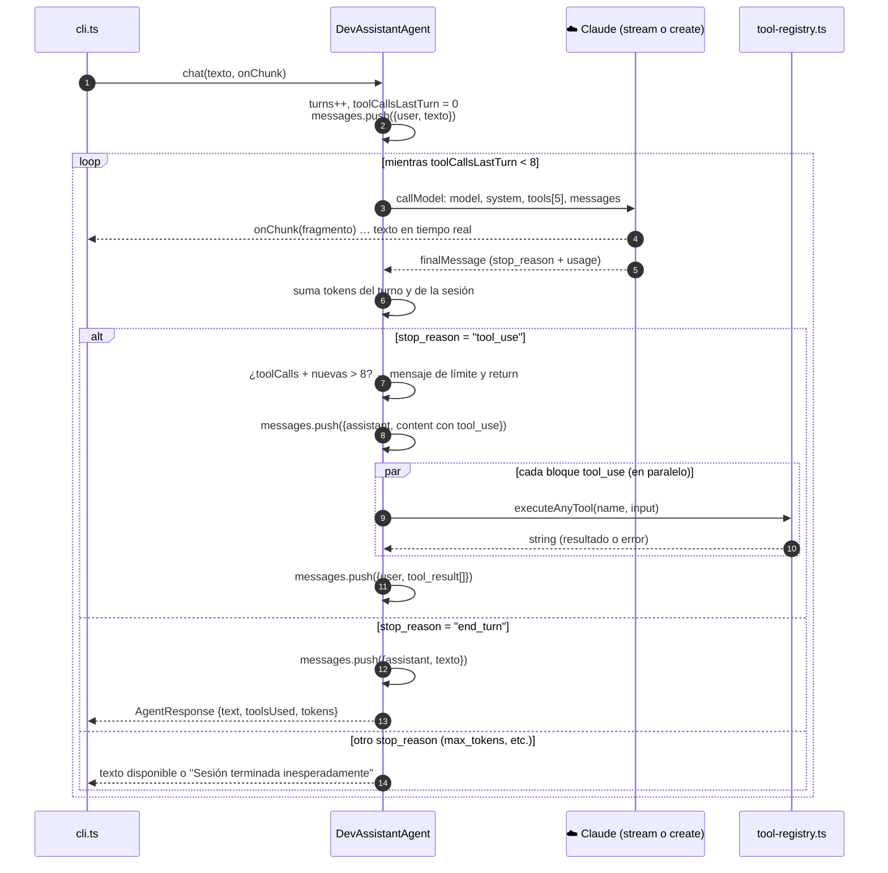

### Estados del loop

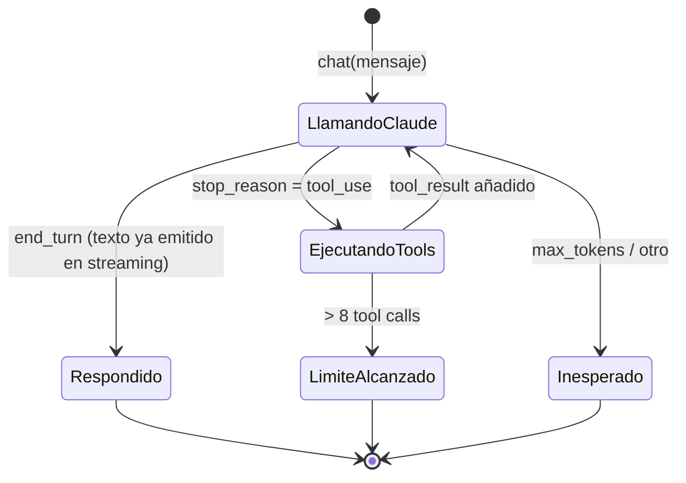

**Historial de mensajes** tras un turno con una tool:

```text
[user]      "¿Cómo me autentico?"
[assistant] [text?, tool_use{id: toolu_1, name: search_docs, input:{query}}]
[user]      [tool_result{tool_use_id: toolu_1, content: "Se encontraron 5 fragmentos…"}]
[assistant] "TaskFlow usa JWT…"          ← texto final (de la misma llamada en streaming)
```

## 5. Tool `search_docs` (consulta RAG) ✅

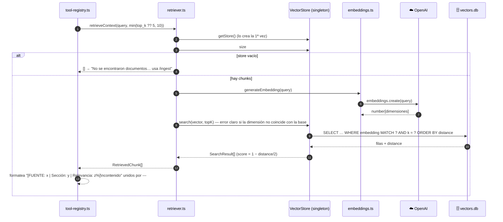

## 6. Tools de archivos con sandbox ✅

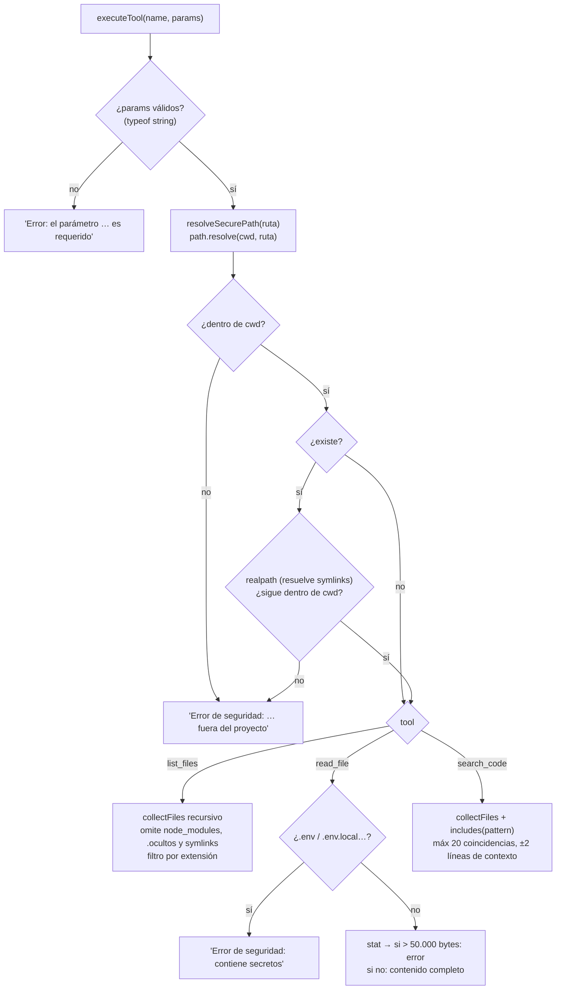

## 7. Tool `create_issue` ✅

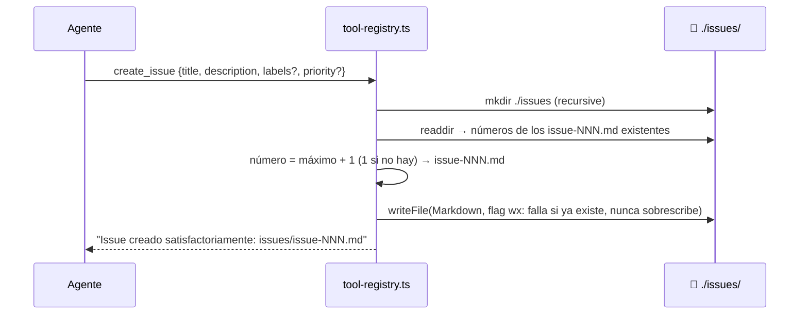

Formato del archivo generado:

```markdown
# Issue #1: Título

## Metadata

- **Fecha:** 2026-11-25
- **Prioridad:** high
- **Etiquetas:** bug, rag
- **Estado:** abierto

## Descripción

Texto de la descripción

---

*Issue creado automáticamente por DevAssistant*
```

## 8. Code review (`npm run review`) ✅

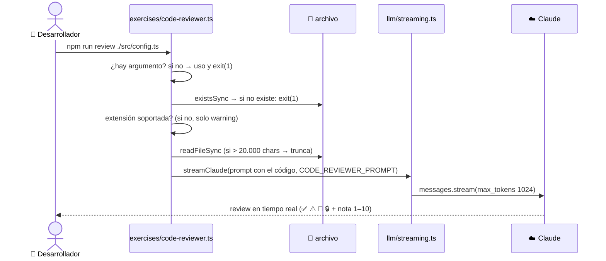

## 9. Demo automática (`npm run demo`) ✅

Ejecuta 4 escenarios con un mismo `DevAssistantAgent`, llamando a `clearHistory()` y esperando 800 ms entre ellos:

| # | Escenario | Pregunta | Tools esperadas |
|---|---|---|---|
| 1 | Exploración de código | "¿Qué funciones y valores exporta src/rag/retriever.ts?" | `read_file` o `search_code` |
| 2 | Búsqueda en docs | "¿Cómo se autentican las peticiones a la API…?" | `search_docs` (requiere ingesta previa) |
| 3 | Tarea multi-tool | "Lista los archivos de src/agent y lee el system prompt" | `list_files` + `read_file` |
| 4 | Crear issue | "Crea un issue de tipo bug: el vector store falla…" | `create_issue` → escribe en `issues/` |

## 10. RAG directo sin agente (`askWithRAG`) ✅

> No está conectado a la CLI.

`rag/rag-chain.ts` implementa el patrón RAG "clásico": recuperar → construir prompt aumentado → responder en streaming con un system prompt que obliga a usar **solo** el contexto. No lo usa ningún punto de entrada actual; es la versión previa (Sección RAG del curso) a convertir el RAG en una tool del agente.

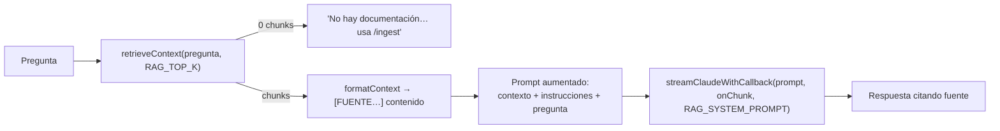

---

> 📝 **Plantilla — preguntas a responder en tu proyecto**
> 1. ¿Cuáles son los flujos principales (arranque, operación central, flujos secundarios)?
> 2. Para cada uno: ¿quién participa y en qué orden? (diagrama de secuencia)
> 3. ¿Qué decisiones/ramas hay? (diagrama de actividad o de estados)
> 4. ¿Qué efectos secundarios produce (archivos, red, BD)?
