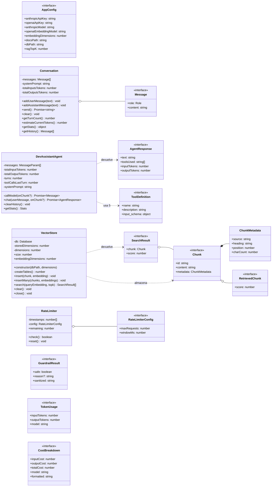
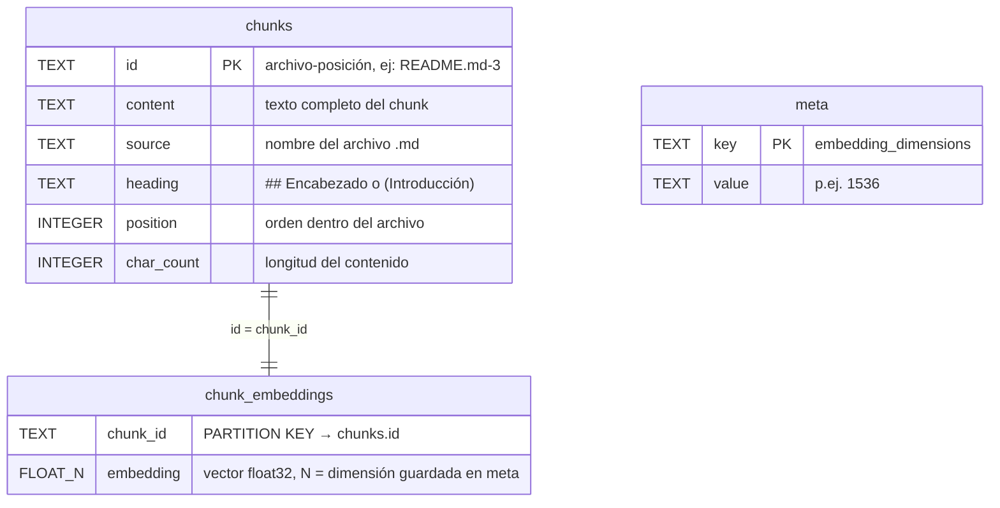
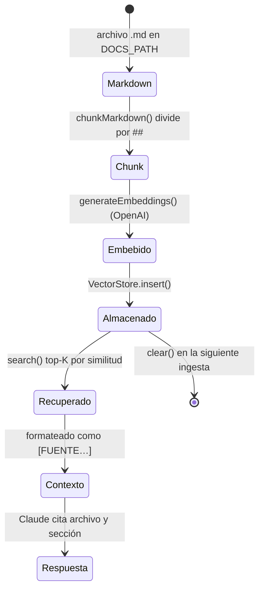

# 05 · Modelo de datos

> **Propósito de esta sección:** describir las estructuras de datos (interfaces TypeScript), las clases con estado y el esquema de la base de datos.

## 🧬 Diagrama de clases UML



Tipo unión (`src/types.ts`):

```ts
type Role = "user" | "assistant";
```

## 📋 Descripción de cada estructura

| Estructura | Archivo | Qué representa | Quién la produce | Quién la consume |
|---|---|---|---|---|
| `Message` | `interface.ts` | Mensaje simple de texto (rol + contenido) | `Conversation` | `Conversation.send()` |
| `ToolDefinition` | `interface.ts` | Esquema de una tool en formato Anthropic (`name`, `description`, `input_schema` JSON Schema) | `tools/definitions.ts`, `agent/tool-registry.ts` | `DevAssistantAgent`, `runWithTools`, `/tools` |
| `Chunk` | `interface.ts` | Fragmento de documento listo para indexar | `chunker.ts` | `VectorStore.insert`, ingesta |
| `RetrievedChunk` | `interface.ts` | `Chunk` + `score` de similitud | `retriever.ts` | `search_docs`, `rag-chain.ts` |
| `SearchResult` | `interface.ts` | Par `{chunk, score}` devuelto por la BD | `VectorStore.search` | `retriever.ts` |
| `AgentResponse` | `interface.ts` | Resultado de un turno del agente | `DevAssistantAgent.chat` | `cli.ts`, `demo.ts` |
| `AppConfig` | `interface.ts` | Configuración tipada de toda la app | `config.ts` | Todos los módulos |
| `GuardrailResult` | `security/guardrails.ts` | Veredicto de seguridad + texto sanitizado | `checkGuardrails` | `cli.ts` |
| `RateLimiterConfig` | `security/guardrails.ts` | Máx. peticiones por ventana de tiempo | `createRateLimiter` | `RateLimiter` |
| `TokenUsage` / `CostBreakdown` | `utils/cost-calculator.ts` | Entrada y salida del cálculo de costo | `cli.ts` | `calculateCost` |

### Ejemplo de `Chunk` real (corpus TaskFlow)

```json
{
  "id": "api-reference.md-1",
  "content": "# TaskFlow API Reference\n\n## Base URL\n\n```\nhttps://api.taskflow.app/v1\n```\n\nPara desarrollo local:\n\n```\nhttp://localhost:3000/v1\n```",
  "metadata": {
    "source": "api-reference.md",
    "heading": "## Base URL",
    "position": 1,
    "charCount": 132
  }
}
```

Fíjate en que el contenido empieza con `# TaskFlow API Reference`: es el **párrafo de solapamiento** que viene del chunk anterior.

## 🗄️ Esquema de la base de datos (`data/vectors.db`)



- `chunks` es una tabla normal de SQLite.
- `chunk_embeddings` es una **tabla virtual `vec0`** de `sqlite-vec`. La búsqueda KNN se hace con `WHERE embedding MATCH ? AND k = ?` y devuelve una columna `distance` (distancia L2).
- Los embeddings se guardan como `Buffer` de un `Float32Array` (`serializeEmbedding`).
- **Score**: `1 − distance / 2`. Como los embeddings de OpenAI están normalizados, la distancia L2 está entre 0 y 2, así que el score queda entre 0 y 1 (1 = idéntico).
- La BD usa `journal_mode = WAL` → por eso existen `vectors.db-wal` y `vectors.db-shm`.
- La dimensión del vector (`float[N]`) se decide al **crear** la tabla con `config.embeddingDimensions` y se guarda en la tabla `meta` (`embedding_dimensions`). Si cambias de modelo de embeddings, la base sigue con la dimensión anterior hasta que vuelvas a ingestar: `clear()` borra la tabla y la recrea con la dimensión nueva. Insertar o buscar con otra dimensión lanza un error explicativo.
- Las bases creadas antes de existir la tabla `meta` se reconocen automáticamente como de 1536 dimensiones.

## 🔄 Ciclo de vida de un Chunk



## 🧾 Estructuras de mensajes de la API de Anthropic usadas

| Bloque | Dirección | Contenido clave |
|---|---|---|
| `text` | Claude → app | Texto de respuesta |
| `tool_use` | Claude → app | `id`, `name`, `input` (JSON con los parámetros) |
| `tool_result` | app → Claude (en un mensaje `user`) | `tool_use_id` (el mismo `id`), `content` (string) |
| `usage` | Claude → app | `input_tokens`, `output_tokens` (se acumulan para `/stats`) |
| `stop_reason` | Claude → app | `end_turn`, `tool_use`, `max_tokens`… (decide el siguiente paso del loop) |

## 📄 Archivos de datos generados

| Archivo | Generado por | Contenido |
|---|---|---|
| `data/vectors.db` (+ `-wal`, `-shm`) | `VectorStore` | Chunks y embeddings |
| `data/chunks-preview.json` | `npm run ingest` | Por chunk: id, primeros 200 chars, metadata, primeros 5 valores del embedding y número de dimensiones |
| `issues/issue-NNN.md` | tool `create_issue` | Issue en Markdown |

---

> 📝 **Plantilla — preguntas a responder en tu proyecto**
> 1. ¿Cuáles son las entidades/interfaces principales y sus campos?
> 2. ¿Qué clases tienen estado y qué métodos exponen?
> 3. ¿Cómo es el esquema de persistencia?
> 4. ¿Cuál es el ciclo de vida de la entidad central?
