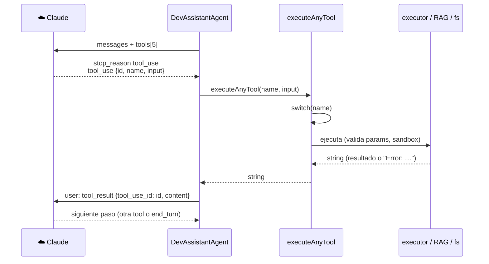

# 06 · Funciones y tools

> **Propósito de esta sección:** documentar las funciones públicas del proyecto y las 5 herramientas (tools) que el modelo puede invocar mediante function calling.

## ⚙️ Funciones públicas por módulo ✅

| Módulo | Función / clase | Firma | Qué hace |
|---|---|---|---|
| `config.ts` | `config` | `AppConfig` | Configuración cargada del `.env` |
| `config.ts` | `validateConfig()` | `() => void` | Lanza error si falta `ANTHROPIC_API_KEY`; avisa si falta `OPENAI_API_KEY` |
| `chat/cli.ts` | `startCLI()` | `() => Promise<void>` | Abre la CLI interactiva |
| `agent/agent.ts` | `DevAssistantAgent` | `new (systemPrompt?)` | Agente con historial; `chat()`, `clearHistory()`, `getStats()` |
| `agent/tool-registry.ts` | `ALL_TOOL_DEFINITIONS` | `ToolDefinition[]` | Las 5 tools del agente |
| `agent/tool-registry.ts` | `executeAnyTool(name, params)` | `=> Promise<string>` | Despacha cualquier tool por nombre |
| `tools/definitions.ts` | `TOOL_DEFINITIONS` | `ToolDefinition[]` | Las 3 tools de archivos |
| `tools/executor.ts` | `executeTool(name, params)` | `=> Promise<string>` | Ejecuta las 3 tools de archivos con validación y sandbox (`realpath`) |
| `tools/executor.ts` | `isSecretFile(path)` | `=> boolean` | `true` para `.env`, `.env.local`…; `false` para `.env.template/.example/.sample` |
| `tools/agent-loop.ts` | `runWithTools(prompt, system?, tools?)` | `=> Promise<string>` | Loop de tools mínimo sin historial (máx. 10 iteraciones) |
| `rag/chunker.ts` | `chunkMarkdown(content, filePath)` | `=> Chunk[]` | Divide un Markdown en chunks |
| `rag/chunker.ts` | `processDirectory(dirPath)` | `=> Promise<Chunk[]>` | Chunks de todos los `.md` del directorio **y sus subcarpetas** |
| `rag/embeddings.ts` | `generateEmbedding(text)` | `=> Promise<number[]>` | Embedding de un texto |
| `rag/embeddings.ts` | `generateEmbeddings(texts)` | `=> Promise<number[][]>` | Embeddings en lotes de 100 textos |
| `rag/embeddings.ts` | `getEmbeddingTokensUsed()` | `=> number` | Tokens de embeddings consumidos en el proceso (para `/stats`) |
| `rag/vector-store.ts` | `VectorStore` | `new (dbPath, dimensions)` | `insert`, `insertMany`, `search`, `clear`, `size`, `embeddingDimensions`, `close` |
| `rag/retriever.ts` | `retrieveContext(query, topK?)` | `=> Promise<RetrievedChunk[]>` | Búsqueda semántica usando el store singleton |
| `rag/retriever.ts` | `resetStore()` | `() => void` | Cierra y olvida el singleton (tras re-ingestar) |
| `rag/rag-chain.ts` | `askWithRAG(question, onChunk?)` | `=> Promise<string>` | RAG completo sin agente, con streaming |
| `rag/indexer.ts` | `indexDocuments(docsPath, {dbPath?, previewPath?})` | `=> Promise<IndexResult>` | Pipeline de ingesta compartido (CLI y script); no toca la base si no hay `.md` |
| `rag/ingest.ts` | `runIngest(docsPath?)` | `=> Promise<void>` | Envoltorio de `indexDocuments` con preview JSON; solo se autoejecuta como script |
| `llm/anthropic-client.ts` | `client` | `Anthropic` | Cliente compartido del SDK |
| `llm/anthropic-client.ts` | `askClaude(prompt, system?)` | `=> Promise<string>` | Una llamada simple, devuelve el texto |
| `llm/streaming.ts` | `streamClaude(prompt, system?)` | `=> Promise<string>` | Streaming directo a stdout |
| `llm/streaming.ts` | `streamClaudeWithCallback(prompt, onChunk, system?)` | `=> Promise<string>` | Streaming con callback por fragmento |
| `llm/prompts.ts` | `CODE_REVIEWER_PROMPT`, `DOCUMENTATION_ASSISTANT_PROMPT`, `DOCUMENTATION_GENERATOR_PROMPT` | `string` | System prompts reutilizables |
| `chat/conversation.ts` | `Conversation` | `new (systemPrompt?)` | Chat multi-turno sin tools |
| `security/guardrails.ts` | `sanitizeInput`, `detectPromptInjection`, `checkGuardrails`, `createRateLimiter`, `RateLimiter` | — | Ver [13 · Seguridad](13-seguridad.md) |
| `utils/cost-calculator.ts` | `calculateCost(usage)` | `=> CostBreakdown` | Costo USD por tokens y modelo |
| `utils/cost-calculator.ts` | `formatUSD(amount)` | `=> string` | Formatea importes (`$0.0480`, `< $0.001`) |

## 🛠️ Catálogo de tools (function calling) ✅

| Tool | Definida en | Ejecutada por | Efecto | Parámetros obligatorios |
|---|---|---|---|---|
| `list_files` | `tools/definitions.ts` | `tools/executor.ts` | Solo lectura | `path` |
| `read_file` | `tools/definitions.ts` | `tools/executor.ts` | Solo lectura | `file_path` |
| `search_code` | `tools/definitions.ts` | `tools/executor.ts` | Solo lectura | `pattern` |
| `search_docs` | `agent/tool-registry.ts` | `agent/tool-registry.ts` → `rag/retriever.ts` | Solo lectura + llamada a OpenAI | `query` |
| `create_issue` | `agent/tool-registry.ts` | `agent/tool-registry.ts` | **Escribe en disco** (`./issues/`) | `title`, `description` |

### `list_files`

Lista recursivamente los archivos de un directorio del proyecto.

| Parámetro | Tipo | Req. | Descripción |
|---|---|---|---|
| `path` | string | ✔ | Directorio relativo al proyecto (`'.'`, `'./src'`) |
| `extension` | string | | Filtro, ej. `'.ts'` |

- Omite `node_modules`, todo lo que empiece por `.` (`.env`, `.github`…) y los enlaces simbólicos.
- Devuelve rutas relativas, una por línea. Errores: ruta fuera del proyecto, no existe, no es directorio, sin resultados.

```json
{ "name": "list_files", "input": { "path": "./src/agent", "extension": ".ts" } }
```
```text
src\agent\agent.ts
src\agent\demo.ts
src\agent\system-prompt.ts
src\agent\tool-registry.ts
```

### `read_file`

Lee un archivo completo.

| Parámetro | Tipo | Req. | Descripción |
|---|---|---|---|
| `file_path` | string | ✔ | Ruta relativa con nombre y extensión |

- Si el archivo pesa más de **50.000 bytes** devuelve un error en lugar del contenido.
- **No lee archivos de secretos**: `.env`, `.env.local`, `.env.production`… (sí `.env.template`, `.env.example`, `.env.sample`).
- Errores: fuera del proyecto (también vía symlink), archivo de secretos, es un directorio, no existe (`ENOENT`).

### `search_code`

Búsqueda por **substring exacto** (sensible a mayúsculas) en los archivos.

| Parámetro | Tipo | Req. | Descripción |
|---|---|---|---|
| `pattern` | string | ✔ | Texto literal (no regex) |
| `path` | string | | Directorio (por defecto `.`) |
| `file_extension` | string | | Filtro, ej. `'.ts'` |

- Máximo **20 coincidencias**, cada una con **±2 líneas** de contexto. La línea que coincide se marca con `>`.

```text
Coincidencias: 1

  src\rag\retriever.ts: 11: }
  src\rag\retriever.ts: 12: export async function retrieveContext(
> src\rag\retriever.ts: 13: ...
```

### `search_docs`

Búsqueda semántica en la documentación ingestada.

| Parámetro | Tipo | Req. | Descripción |
|---|---|---|---|
| `query` | string | ✔ | Pregunta o tema |
| `top_k` | number | | Fragmentos a recuperar (por defecto 5, máximo 10) |

- Si el store está vacío, responde pidiendo ejecutar `/ingest`.
- Formato del resultado:

```text
Se encontraron 5 fragmentos relevantes:

[FUENTE: api-reference.md | Sección: ## Autenticación | Relevancia: 78%]
## Autenticación
…

---

[FUENTE: getting-started.md | Sección: ## Autenticación con JWT | Relevancia: 74%]
…
```

> Nota: `search_docs` usa `top_k ?? 5`, **no** `RAG_TOP_K`. `RAG_TOP_K` solo lo usan `retrieveContext()` sin argumento y `askWithRAG()`.

### `create_issue`

Crea un issue Markdown en `./issues/`.

| Parámetro | Tipo | Req. | Descripción |
|---|---|---|---|
| `title` | string | ✔ | Título conciso |
| `description` | string | ✔ | Descripción detallada |
| `labels` | string[] | | Ej. `["bug","rag"]` (por defecto "sin etiquetas") |
| `priority` | `"low" \| "medium" \| "high"` | | Por defecto `medium` |

- Numeración automática: **mayor `issue-NNN.md` existente + 1** → `issue-001.md`, `issue-002.md`… Si borras uno intermedio, el número no se reutiliza.
- Se escribe con el flag `wx`: si por algún motivo el archivo ya existe, la tool devuelve un error en lugar de sobrescribirlo.

## 🔁 Ciclo de vida de una invocación de tool



## ➕ Cómo añadir una tool nueva (receta)

1. **Definir el esquema** en `src/agent/tool-registry.ts` (o en `tools/definitions.ts` si es de archivos):
   ```ts
   const MI_TOOL: ToolDefinition = {
     name: "mi_tool",
     description: "Qué hace y CUÁNDO debe usarla el modelo.",
     input_schema: {
       type: "object",
       properties: { param: { type: "string", description: "…" } },
       required: ["param"],
     },
   };
   ```
2. **Implementar** una función `async function executeMiTool(params): Promise<string>` que **nunca lance excepciones**: captura errores y devuelve `"Error: …"`.
3. **Registrar** la definición en `ALL_TOOL_DEFINITIONS`.
4. **Despachar** añadiendo un `case "mi_tool":` en el `switch` de `executeAnyTool`, y actualiza el texto "Tools disponibles" del `default`.
5. **Enseñar al modelo**: añade la tool y su regla de decisión en `src/agent/system-prompt.ts` (hoy dice "Tienes acceso a 5 herramientas").
6. Si toca el sistema de archivos, reutiliza el patrón `resolveSecurePath` de `tools/executor.ts`.
7. Añade un caso en `tests/tools.test.ts` (las tools se pueden probar sin API), ejecuta `npm run typecheck` y `npm test`, y pruébala con `/tools` y una pregunta en `npm run dev`.

## ✅ Buenas prácticas aplicadas en las tools

- **Descripciones orientadas a "cuándo usarla"**, no solo a qué hace: el modelo decide con ellas.
- **Validación de tipos en tiempo de ejecución** (`typeof p.path !== "string"`): el `input` del modelo no es de confianza.
- **Errores como texto**: el modelo los lee y puede reintentar con otros parámetros.
- **Límites de tamaño** (50.000 bytes, 20 coincidencias, top_k ≤ 10) para no saturar el contexto.
- **Sandbox** de rutas con `realpath`, exclusión de archivos ocultos y bloqueo explícito de `.env*`.

---

> 📝 **Plantilla — preguntas a responder en tu proyecto**
> 1. ¿Qué funciones públicas expone cada módulo?
> 2. ¿Qué tools puede invocar el modelo, con qué parámetros y efectos?
> 3. ¿Cómo se añade una nueva?
> 4. ¿Qué validaciones y límites aplica cada tool?
