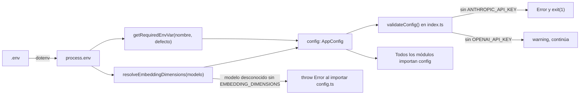

# 07 · Configuración y ejecución

> **Propósito de esta sección:** cómo se instala, configura y ejecuta el proyecto. Para un tutorial paso a paso, ver [11 · Guía de uso](11-guia-de-uso.md).

## 🚀 Puesta en marcha

```bash
cd DEV-ASSITANT
npm install
cp .env.template .env     # y edita las API keys
npm run typecheck         # verificación estática (src + tests)
npm test                  # 41 tests, sin llamar a APIs
npm run dev               # CLI interactiva
```

Requisitos: **Node.js 18+** (probado con Node 22), npm 9+, API key de **Anthropic** (obligatoria) y de **OpenAI** (para RAG).

## 🔐 Variables de entorno

| Variable | Obligatoria | Por defecto | Usada en | Descripción |
|---|---|---|---|---|
| `ANTHROPIC_API_KEY` | ✔ | `""` | `llm/anthropic-client.ts` | Key de Claude. Sin ella la CLI no arranca |
| `OPENAI_API_KEY` | Para RAG | `""` | `rag/embeddings.ts` | Key de OpenAI (solo embeddings). Sin ella fallan `/ingest` y `search_docs` |
| `ANTHROPIC_MODEL` | | `claude-sonnet-4-6` | agente, streaming, conversación, `/stats` | Modelo de Claude |
| `OPENAI_EMBEDDING_MODEL` | | `text-embedding-3-small` | `rag/embeddings.ts`, `config.ts` | Modelo de embeddings. Si lo cambias, vuelve a ingestar |
| `EMBEDDING_DIMENSIONS` | Solo para modelos desconocidos | según el modelo (`3-small`/`ada-002` → 1536, `3-large` → 3072) | `config.ts`, `VectorStore` | Dimensión de los vectores (ver [05](05-modelo-datos.md)) |
| `DOCS_PATH` | | `./docs/sample-project` | `/ingest` sin ruta, `npm run ingest` | Directorio con los `.md` a indexar (incluye subcarpetas) |
| `DB_PATH` | | `./data/vectors.db` | `VectorStore` | Ruta de la base vectorial (se crea la carpeta si no existe) |
| `RAG_TOP_K` | | `5` | `retrieveContext()` por defecto, `askWithRAG()` | Chunks a recuperar |

> Todas las rutas relativas se resuelven respecto al **directorio desde el que ejecutas** el comando. Ejecuta siempre desde la raíz `DEV-ASSITANT/`.

## 🧭 Flujo de carga de configuración



## 📜 Comandos npm

| Comando | Ejecuta | Llama a APIs de pago | Descripción |
|---|---|---|---|
| `npm run dev` / `npm start` | `tsx src/index.ts` | Sí | CLI interactiva con el agente |
| `npm run ingest` | `tsx src/rag/ingest.ts` | Sí (OpenAI) | Indexa `DOCS_PATH` en `DB_PATH` y escribe `data/chunks-preview.json` |
| `npm run demo` | `tsx src/agent/demo.ts` | Sí (Claude, y OpenAI si hay docs) | 4 escenarios automáticos del agente |
| `npm run review <archivo>` | `tsx src/exercises/code-reviewer.ts` | Sí (Claude) | Code review de un archivo en streaming |
| `npm run typecheck` | `tsc --noEmit && tsc -p tests/tsconfig.json` | No | Typecheck de `src/` y de `tests/` |
| `npm test` | `tsx --test "tests/**/*.test.ts"` | **No** | 41 tests con `node:test` (chunker, vector store, guardrails, costos, tools) |
| `npm run build` | `tsc` | No | Compila a `dist/` (JS + `.d.ts` + source maps) |
| `npx tsx src/security/examples.ts` | — | **No** | Demostración de los guardrails (sin script npm) |
| `npx tsx src/<ruta>.ts` | — | Depende | Ejecutar cualquier módulo suelto |

## ⌨️ Comandos dentro de la CLI

| Comando | Alias | Qué hace |
|---|---|---|
| `/ingest [ruta]` | | Indexa los `.md` de `ruta` (o `DOCS_PATH`) y sus subcarpetas. **Reemplaza** el índice anterior (si no hay `.md`, no lo toca) |
| `/stats` | | Turnos de la conversación, tokens de Claude y de embeddings acumulados en la sesión, costo estimado (chat + embeddings), tool calls del último turno |
| `/tools` | | Lista las 5 tools con sus parámetros y la primera frase de su descripción |
| `/clear` | `/limpiar` | Borra el historial del agente. Los tokens y el costo de la sesión se mantienen (a propósito) |
| `/exit` | `/salida` | Muestra el resumen y cierra |
| *cualquier otro texto* | | Pasa por los guardrails y se envía al agente |

## ⚙️ Constantes internas (no configurables por `.env`)

| Constante | Valor | Archivo | Efecto |
|---|---|---|---|
| `MAX_TOOL_CALLS` | 8 | `agent/agent.ts` | Tool calls por turno del agente |
| `max_tokens` | 4096 / 1024 | `agent.ts` / `streaming.ts`, `conversation.ts`, `anthropic-client.ts` | Tokens máximos de salida por llamada |
| `MAX_ITERATIONS` | 10 | `tools/agent-loop.ts` | Iteraciones del loop simple |
| `MAX_CHUNK_SIZE` | 2000 | `rag/chunker.ts` | Caracteres por chunk |
| `BATCH_SIZE` | 100 | `rag/embeddings.ts` | Textos por petición de embeddings |
| `MAX_FILE_SIZE` | 50.000 | `tools/executor.ts` | Bytes máximos para `read_file` |
| `MAX_SEARCH_RESULTS` / `CONTEXT_LINES` | 20 / 2 | `tools/executor.ts` | Límite y contexto de `search_code` |
| `MAX_LENGTH` | 8.000 | `security/guardrails.ts` | Caracteres máximos de entrada |
| Rate limit | 10 peticiones / 60 s | `security/guardrails.ts` (`createRateLimiter`) | Mensajes al agente por minuto |
| `MAX_CHARS` | 20.000 | `exercises/code-reviewer.ts` | Caracteres revisados por archivo |
| `PRICING` | tabla | `utils/cost-calculator.ts` | Precios USD por millón de tokens (fallback: Sonnet) |

## ☁️ GitHub Codespaces

- `.devcontainer/devcontainer.json`: imagen `typescript-node:22`, ejecuta `.github/codespaces/post-create.sh` al crear el contenedor, declara los secrets `ANTHROPIC_API_KEY` y `OPENAI_API_KEY` y recomienda la extensión de Mermaid para VS Code.
- `post-create.sh`: `npm install`, crea `data/` y copia `.env.template` a `.env` si no existe.
- Codespaces inyecta los secrets como variables de entorno; `dotenv` **no** sobrescribe variables ya definidas, así que los valores de ejemplo del `.env` copiado no las pisan.

## 📂 Archivos generados (ignorados en git)

| Ruta | Generado por | ¿Se puede borrar? |
|---|---|---|
| `data/vectors.db`, `-wal`, `-shm` | `/ingest`, `npm run ingest`, primera búsqueda | Sí: se recrea vacío; hay que re-ingestar |
| `data/chunks-preview.json` | `npm run ingest` | Sí (solo informativo) |
| `issues/*.md` | tool `create_issue` | Sí |
| `dist/` | `npm run build` | Sí |
| `.env` | tú | No (contiene tus keys) |

---

> 📝 **Plantilla — preguntas a responder en tu proyecto**
> 1. ¿Qué se necesita instalar y cómo se arranca?
> 2. ¿Qué variables de entorno existen, cuáles son obligatorias y dónde se usan?
> 3. ¿Qué comandos hay y cuáles cuestan dinero?
> 4. ¿Qué constantes internas conviene conocer?
> 5. ¿Qué archivos se generan y se pueden borrar?
