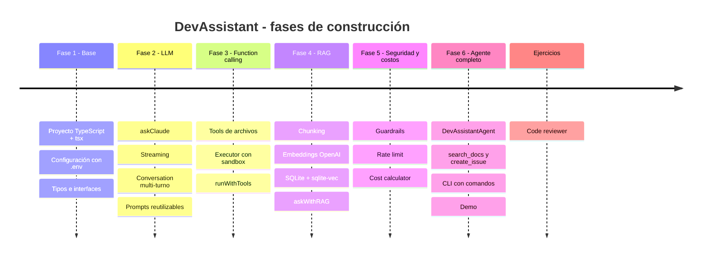

# 08 · Roadmap

> **Propósito de esta sección:** mostrar en qué fase está el proyecto, qué está hecho y qué falta.

## 🧭 Fases (secciones del curso)

## ✅ Estado detallado

| Fase | Entregable | Archivo(s) | Estado |
|---|---|---|---|
| 1 · Base | Proyecto TS (ESM, strict, `tsx`) | `package.json`, `tsconfig.json` | ✅ |
| 1 · Base | Configuración con validación | `config.ts` | ✅ |
| 1 · Base | Interfaces y tipos compartidos | `interface.ts`, `types.ts` | ✅ |
| 2 · LLM | Llamada simple a Claude | `llm/anthropic-client.ts` | ✅ |
| 2 · LLM | Streaming | `llm/streaming.ts` | ✅ |
| 2 · LLM | Conversación multi-turno | `chat/conversation.ts` | ✅ (no usada por la CLI) |
| 2 · LLM | System prompts reutilizables | `llm/prompts.ts` | ✅ |
| 3 · Function calling | Definición de tools de archivos | `tools/definitions.ts` | ✅ |
| 3 · Function calling | Executor con sandbox | `tools/executor.ts` | ✅ |
| 3 · Function calling | Loop de tools simple | `tools/agent-loop.ts` | ✅ (no usado por la CLI) |
| 4 · RAG | Chunking Markdown con solapamiento | `rag/chunker.ts` | ✅ |
| 4 · RAG | Embeddings | `rag/embeddings.ts` | ✅ |
| 4 · RAG | Vector store SQLite | `rag/vector-store.ts` | ✅ |
| 4 · RAG | Retriever + ingesta | `rag/retriever.ts`, `rag/ingest.ts` | ✅ |
| 4 · RAG | Cadena RAG directa | `rag/rag-chain.ts` | ✅ (no usada por la CLI) |
| 5 · Seguridad | Sanitización, prompt injection, rate limit | `security/guardrails.ts` | ✅ |
| 5 · Seguridad | Ejemplos de guardrails | `security/examples.ts` | ✅ |
| 5 · Costos | Calculadora de costos | `utils/cost-calculator.ts` | ✅ |
| 6 · Agente | Agente con loop, límite y streaming | `agent/agent.ts` | ✅ |
| 6 · Agente | Registro de 5 tools | `agent/tool-registry.ts` | ✅ |
| 6 · Agente | CLI con comandos | `chat/cli.ts`, `index.ts` | ✅ |
| 6 · Agente | Demo automatizada | `agent/demo.ts` | ✅ |
| Ejercicio | Code reviewer | `exercises/code-reviewer.ts` | ✅ |
| Calidad | Corrección de 20 bugs detectados al documentar | varios | ✅ (ver [14](14-problemas-conocidos.md)) |
| Calidad | Deuda técnica D1–D17 (streaming real, ingesta unificada, dimensiones, sandbox…) | varios | ✅ (ver [14](14-problemas-conocidos.md)) |
| Calidad | Tests automatizados (`npm test`, 41 tests) | `tests/` | ✅ |
| Calidad | Devcontainer funcional para Codespaces | `.devcontainer/` | ✅ |
| Calidad | Ingesta en lotes y recursiva | `rag/indexer.ts`, `rag/chunker.ts`, `rag/embeddings.ts` | ✅ |
| — | OpenAI como LLM del chat | — | ❌ Descartado: se eliminaron `MODEL_PROVIDER` y `OPENAI_MODEL` |

## 🔜 Siguientes pasos sugeridos

1. **Prompt caching** del system prompt y las tools (cada paso del loop los reenvía).
2. **Varias colecciones** de documentos (hoy cada `/ingest` reemplaza el índice).
3. **Tests con la API simulada** para el loop del agente (`DevAssistantAgent`) y `indexDocuments`.
4. **Defensa contra injection indirecta**: marcar en el system prompt que el contenido de tools es dato, no instrucción.
5. Renombrar la carpeta `DEV-ASSITANT` → `DEV-ASSISTANT` cuando no afecte a otras rutas.
6. Revisar la tabla `PRICING` cuando cambien las tarifas.

## 💭 Ideas futuras (fuera del alcance actual)

- Interfaz web o bot de Slack.
- Indexar fuentes remotas (Confluence, Notion, GitHub Wiki).
- Memoria de conversación persistente.
- Evaluación automática de la calidad de las respuestas.
- Sincronizar `create_issue` con GitHub Issues.
- Prompt caching para reducir el costo del system prompt y las tools en cada llamada.

---

> 📝 **Plantilla — preguntas a responder en tu proyecto**
> 1. ¿En qué fases se divide la construcción?
> 2. ¿Qué entregables tiene cada fase y en qué estado están?
> 3. ¿Qué sigue y qué ideas quedan para después?
