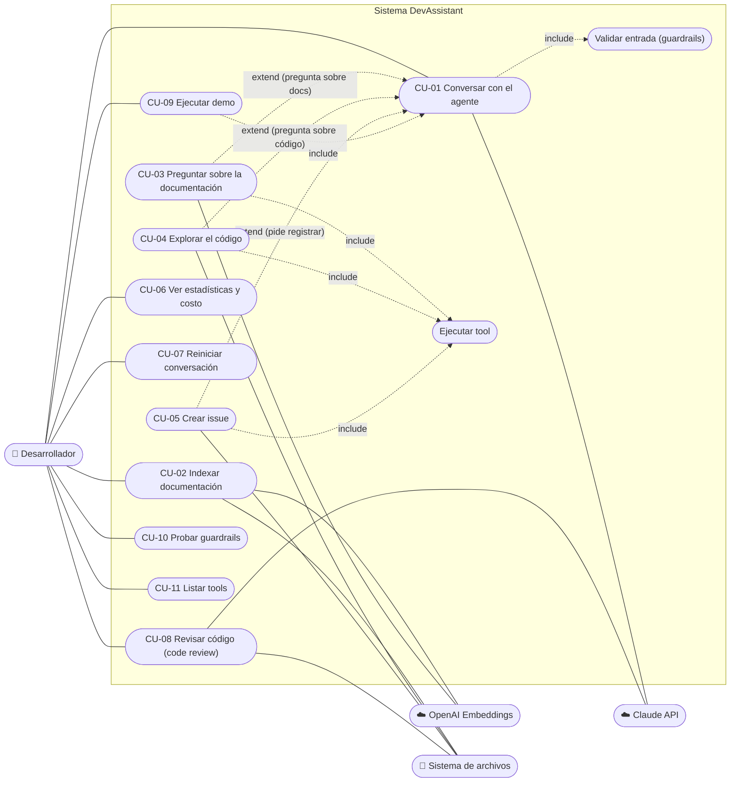

# 10 · Casos de uso

> **Propósito de esta sección:** especificar qué puede hacer cada actor con el sistema, en notación UML de casos de uso, con el detalle de cada caso (precondiciones, flujo principal, alternativas y postcondiciones).

## 👥 Actores

| Actor | Tipo | Descripción |
|---|---|---|
| **Desarrollador** | Primario (humano) | Usa la CLI y los scripts npm |
| **Claude (Anthropic API)** | Secundario (sistema externo) | Razona, decide tools y redacta respuestas |
| **OpenAI Embeddings API** | Secundario (sistema externo) | Convierte texto en vectores |
| **Sistema de archivos** | Secundario (recurso) | Código del proyecto, docs, `vectors.db`, `issues/` |

## 🧩 Diagrama UML de casos de uso

> Mermaid no tiene un diagrama de casos de uso nativo; se representa con un flowchart: los óvalos son casos de uso, el rectángulo grande es el límite del sistema y las flechas punteadas son relaciones `<<include>>` / `<<extend>>`.

## 📋 Resumen

| ID | Caso de uso | Actor primario | Disparador | Estado |
|---|---|---|---|---|
| CU-01 | Conversar con el agente | Desarrollador | Texto libre en la CLI | ✅ |
| CU-02 | Indexar documentación | Desarrollador | `/ingest [ruta]` o `npm run ingest` | ✅ |
| CU-03 | Preguntar sobre la documentación | Desarrollador (vía agente) | Pregunta "¿cómo…?" → `search_docs` | ✅ |
| CU-04 | Explorar el código | Desarrollador (vía agente) | Pregunta sobre código → `list_files` / `read_file` / `search_code` | ✅ |
| CU-05 | Crear issue | Desarrollador (vía agente) | "Crea un issue…" → `create_issue` | ✅ |
| CU-06 | Ver estadísticas y costo | Desarrollador | `/stats`, `/exit` | ✅ |
| CU-07 | Reiniciar conversación | Desarrollador | `/clear` | ✅ |
| CU-08 | Revisar código | Desarrollador | `npm run review <archivo>` | ✅ |
| CU-09 | Ejecutar demo | Desarrollador | `npm run demo` | ✅ |
| CU-10 | Probar guardrails | Desarrollador | `npx tsx src/security/examples.ts` | ✅ |
| CU-11 | Listar tools | Desarrollador | `/tools` | ✅ |

---

## CU-01 · Conversar con el agente

| Campo | Detalle |
|---|---|
| **Actor primario** | Desarrollador |
| **Actores secundarios** | Claude API (y, según la pregunta, OpenAI y el sistema de archivos) |
| **Objetivo** | Obtener una respuesta útil a una pregunta técnica |
| **Precondiciones** | `.env` con `ANTHROPIC_API_KEY`; CLI abierta (`npm run dev`) desde la raíz del proyecto |
| **Postcondiciones** | La pregunta y la respuesta quedan en el historial; los tokens se acumulan |

**Flujo principal**
1. El desarrollador escribe un texto y pulsa Enter.
2. El sistema sanitiza el texto y comprueba prompt injection y rate limit (*include* "Validar entrada").
3. El sistema envía el historial, el system prompt y las 5 tools a Claude.
4. Claude responde con `end_turn`.
5. El sistema muestra la respuesta en streaming.
6. Si se usaron tools, muestra "Herramientas utilizadas: …".

**Flujos alternativos**
- **2a.** Se detecta injection → muestra "Tu mensaje contiene patrones…" y vuelve al paso 1 sin llamar a la API.
- **2b.** Se supera el rate limit (más de 10 mensajes en 60 s) → muestra "Demasiadas solicitudes…".
- **4a.** Claude pide tools (`tool_use`) → se ejecutan (CU-03/04/05) y se vuelve al paso 3.
- **4b.** Se superan 8 tool calls → responde "He alcanzado el límite de 8 llamadas…".
- **4c.** `stop_reason` inesperado (p. ej. `max_tokens`) → devuelve el texto parcial o "Sesión terminada inesperadamente".
- **E1.** Error de red o de API → "Error: …" y vuelve al paso 1.

## CU-02 · Indexar documentación

| Campo | Detalle |
|---|---|
| **Actor primario** | Desarrollador |
| **Actores secundarios** | OpenAI Embeddings, sistema de archivos |
| **Objetivo** | Que la documentación quede disponible para búsquedas semánticas |
| **Precondiciones** | `OPENAI_API_KEY` válida; el directorio (o sus subcarpetas) contiene archivos `.md` |
| **Postcondiciones** | `vectors.db` contiene **solo** los chunks de esta ingesta (la anterior se borra) |

**Flujo principal**
1. El desarrollador ejecuta `/ingest ./docs/mi-proyecto` (o `/ingest` para usar `DOCS_PATH`).
2. El sistema recorre la carpeta y sus subcarpetas, lee cada `.md` y lo divide en chunks (`indexDocuments` en `rag/indexer.ts`).
3. El sistema pide los embeddings a OpenAI en lotes de 100 textos y comprueba su dimensión.
4. El sistema reinicia el singleton del retriever, vacía la base (recreando la tabla de vectores con la dimensión actual) e inserta chunks y vectores en una transacción.
5. El sistema muestra "N chunks de M archivos almacenados".

**Flujos alternativos**
- **2a.** El directorio no existe → "No se pudo leer el directorio: …".
- **2b.** No hay `.md` → "No se encontraron archivos .md (no se modificó el índice)".
- **3b.** La dimensión de los vectores no coincide con `EMBEDDING_DIMENSIONS` / el modelo → error y la base queda intacta.
- **3a.** Key de OpenAI inválida o sin saldo → error de la API; la base anterior queda intacta (todavía no se había vaciado).
- **Variante `npm run ingest`**: mismos pasos, y además escribe `data/chunks-preview.json`.

## CU-03 · Preguntar sobre la documentación

| Campo | Detalle |
|---|---|
| **Actor primario** | Desarrollador (a través de Claude) |
| **Extiende** | CU-01 cuando la pregunta trata sobre la documentación |
| **Precondiciones** | CU-02 ejecutado al menos una vez |
| **Postcondiciones** | Respuesta que cita archivo y sección |

**Flujo principal**
1. Claude decide llamar a `search_docs` con una `query`.
2. El sistema embebe la query (OpenAI) y busca los 5 chunks más parecidos (máx. 10).
3. El sistema devuelve los fragmentos con `[FUENTE | Sección | Relevancia]`.
4. Claude redacta la respuesta citando las fuentes.

**Alternativos**
- **2a.** La base está vacía → la tool responde "No se encontraron documentos… usa /ingest" y Claude se lo comunica al usuario.

## CU-04 · Explorar el código

| Campo | Detalle |
|---|---|
| **Actor primario** | Desarrollador (a través de Claude) |
| **Extiende** | CU-01 cuando la pregunta trata sobre el código |
| **Precondiciones** | CLI ejecutada desde la raíz del proyecto (define el sandbox) |
| **Postcondiciones** | Ninguna (solo lectura) |

**Flujo principal**
1. Claude llama a `list_files` para orientarse (opcional).
2. Claude llama a `read_file` o `search_code`.
3. El sistema valida los parámetros, resuelve la ruta dentro del sandbox y devuelve el resultado.
4. Claude responde con rutas y fragmentos de código.

**Alternativos**
- **3a.** La ruta sale del proyecto (`../`) → "Error de seguridad…" (Claude puede reintentar).
- **3b.** El archivo no existe, es un directorio o pesa más de 50 KB → mensaje de error descriptivo.
- **3d.** El archivo es de secretos (`.env`, `.env.local`…) o un symlink que apunta fuera del proyecto → "Error de seguridad…".
- **3c.** Más de 20 coincidencias → solo se devuelven las 20 primeras.

## CU-05 · Crear issue

| Campo | Detalle |
|---|---|
| **Actor primario** | Desarrollador (a través de Claude) |
| **Extiende** | CU-01 cuando el usuario pide registrar algo |
| **Precondiciones** | Permiso de escritura en el directorio actual |
| **Postcondiciones** | Nuevo archivo `issues/issue-NNN.md` |

**Flujo principal**
1. El desarrollador pide "Crea un issue de tipo bug: … prioridad alta".
2. Claude llama a `create_issue` con `title`, `description`, `labels` y `priority`.
3. El sistema crea `./issues/` si no existe, calcula el siguiente número (mayor `issue-NNN` existente + 1) y escribe el Markdown sin sobrescribir nunca un archivo existente.
4. Claude confirma la ruta del issue creado.

**Alternativos**
- **3a.** Error de escritura → "Error al crear el issue: …".

## CU-06 · Ver estadísticas y costo

| Campo | Detalle |
|---|---|
| **Precondiciones** | CLI abierta |
| **Flujo** | `/stats` → turnos de la conversación, tokens de Claude y de embeddings acumulados en la sesión, costo estimado (chat + embeddings), tool calls del último turno. `/exit` muestra un resumen al salir. |
| **Alternativo** | Modelo no presente en `PRICING` → aviso y estimación con el precio de Sonnet. |
| **Nota** | Los tokens incluyen todas las llamadas del loop (también las de streaming) y los embeddings de ingestas y `search_docs`. |

## CU-07 · Reiniciar conversación

| Campo | Detalle |
|---|---|
| **Flujo** | `/clear` (o `/limpiar`) → se vacía el historial y se ponen a cero los turnos. |
| **Postcondición** | El agente "olvida" la conversación. Los tokens acumulados **no** se reinician. |

## CU-08 · Revisar código

| Campo | Detalle |
|---|---|
| **Actor primario** | Desarrollador |
| **Actores secundarios** | Claude API, sistema de archivos |
| **Precondiciones** | `ANTHROPIC_API_KEY`; el archivo existe |
| **Flujo principal** | 1. `npm run review ./src/x.ts` · 2. El sistema lee el archivo (máx. 20.000 caracteres) · 3. Lo envía a Claude con `CODE_REVIEWER_PROMPT` · 4. Muestra en streaming la revisión con resumen, ✅ ⚠️ 🐛 🔒 y nota del 1 al 10 |
| **Alternativos** | Sin argumento → muestra el uso y sale con código 1 · Archivo inexistente → sale con código 1 · Extensión desconocida → aviso y continúa · Archivo grande → se trunca con aviso |

## CU-09 · Ejecutar demo

| Campo | Detalle |
|---|---|
| **Flujo** | `npm run demo` → ejecuta 4 escenarios de CU-01 (con CU-04, CU-03, CU-04 multi-tool y CU-05), limpiando el historial entre cada uno. |
| **Postcondición** | Se crea un issue en `issues/`. |
| **Recomendación** | Ejecuta CU-02 antes para que el escenario 2 encuentre documentación. |

## CU-10 · Probar guardrails

| Campo | Detalle |
|---|---|
| **Flujo** | `npx tsx src/security/examples.ts` → imprime casos de sanitización, injection en inglés y español, entradas legítimas, rate limit (5 permitidas de 7) y verificación completa. |
| **Coste** | Ninguno (no llama a APIs). |

## CU-11 · Listar tools

| Campo | Detalle |
|---|---|
| **Flujo** | `/tools` → `• nombre(param1, param2)` + la primera frase de la descripción de cada una de las 5 tools. |

---

## 🔁 Trazabilidad caso de uso → código

| Caso de uso | Archivos principales |
|---|---|
| CU-01 | `chat/cli.ts`, `security/guardrails.ts`, `agent/agent.ts`, `agent/system-prompt.ts` |
| CU-02 | `rag/indexer.ts`, `chat/cli.ts`, `rag/ingest.ts`, `rag/chunker.ts`, `rag/embeddings.ts`, `rag/vector-store.ts` |
| CU-03 | `agent/tool-registry.ts#executeSearchDocs`, `rag/retriever.ts` |
| CU-04 | `tools/definitions.ts`, `tools/executor.ts` |
| CU-05 | `agent/tool-registry.ts#executeCreateIssue` |
| CU-06 | `chat/cli.ts`, `utils/cost-calculator.ts`, `rag/embeddings.ts#getEmbeddingTokensUsed` |
| CU-07 | `agent/agent.ts#clearHistory` |
| CU-08 | `exercises/code-reviewer.ts`, `llm/streaming.ts`, `llm/prompts.ts` |
| CU-09 | `agent/demo.ts` |
| CU-10 | `security/examples.ts` |
| CU-11 | `chat/cli.ts`, `agent/tool-registry.ts` |
