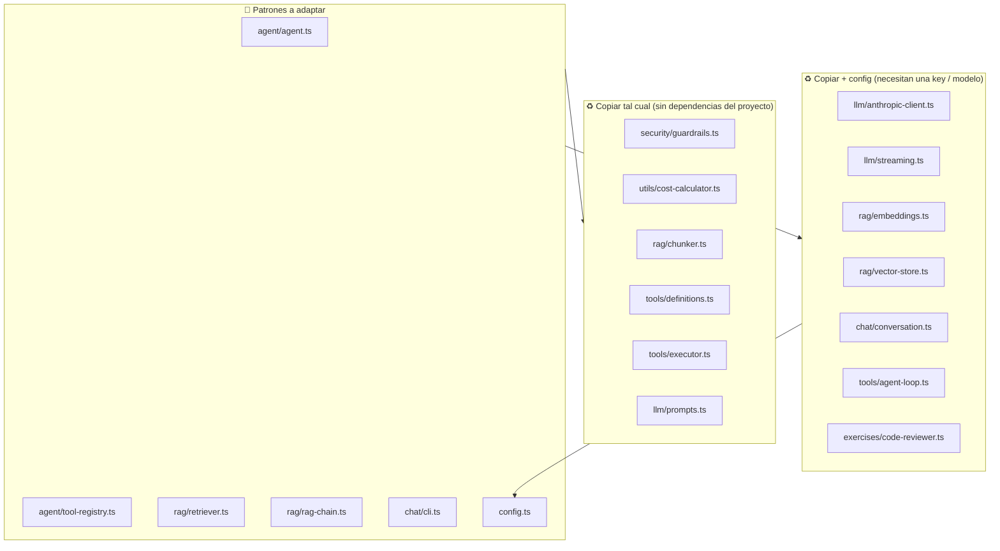

# 12 · Módulos reutilizables

> **Propósito de esta sección:** identificar qué piezas se pueden llevar a otros proyectos, qué necesitan y cómo se usan con un ejemplo mínimo.

## 🧭 Mapa de reutilización



## 📦 Kits recomendados

| Quiero… | Copia estos archivos | Dependencias npm |
|---|---|---|
| **Llamar a Claude** (simple y en streaming) | `config.ts`, `interface.ts`, `types.ts`, `llm/anthropic-client.ts`, `llm/streaming.ts` | `@anthropic-ai/sdk`, `dotenv` |
| **Chat con memoria** | kit anterior + `chat/conversation.ts` | ídem |
| **RAG local sin servidor** | `rag/chunker.ts`, `rag/embeddings.ts`, `rag/vector-store.ts`, `rag/retriever.ts`, `rag/indexer.ts` (+ `rag/rag-chain.ts`) | `openai`, `better-sqlite3`, `sqlite-vec` |
| **Agente con tools** | `agent/agent.ts`, `agent/tool-registry.ts`, `tools/*`, kit "Llamar a Claude" | `@anthropic-ai/sdk` |
| **Seguridad de entrada** | `security/guardrails.ts` | ninguna |
| **Costos de LLM** | `utils/cost-calculator.ts` | ninguna |
| **Code review por CLI** | `exercises/code-reviewer.ts`, `llm/prompts.ts`, kit "Llamar a Claude" | `@anthropic-ai/sdk` |

> Recuerda: el proyecto es **ESM** y los imports relativos llevan la extensión `.js` (`./config.js`) aunque el archivo sea `.ts`.

---

## ♻️ `security/guardrails.ts`

**Contrato:** `checkGuardrails(input, rateLimiter) → { safe, reason?, sanitized }`.

```ts
import { checkGuardrails, createRateLimiter } from "./security/guardrails.js";

const limiter = createRateLimiter({ maxRequests: 20, windowMs: 60_000 });
const g = checkGuardrails(userText, limiter);
if (!g.safe) return reply(g.reason);
await llm(g.sanitized);
```

Para adaptarlo: añade patrones a `INJECTION_PATTERNS` (`{ name, regex }`) y ajusta `MAX_LENGTH`.

## ♻️ `utils/cost-calculator.ts`

```ts
import { calculateCost } from "./utils/cost-calculator.js";
const c = calculateCost({ inputTokens: 12_000, outputTokens: 800, model: "claude-sonnet-4-6" });
console.log(c.formatted); // "$0.0480"
```

Mantén actualizada la tabla `PRICING` (USD por millón de tokens).

## ♻️ `rag/chunker.ts`

```ts
import { chunkMarkdown, processDirectory } from "./rag/chunker.js";
const chunks = chunkMarkdown(markdownText, "guia.md");     // función pura
const all = await processDirectory("./docs");               // todos los .md, incluidas subcarpetas
```

Parámetros a ajustar: `MAX_CHUNK_SIZE` (2000) y la regex de división (`/(?=^## )/m`).

## ♻️ `rag/embeddings.ts` + `rag/vector-store.ts`

```ts
import { generateEmbeddings, generateEmbedding } from "./rag/embeddings.js";
import { VectorStore } from "./rag/vector-store.js";

const store = new VectorStore("./data/vectors.db", 1536);   // o ":memory:" en tests
const vectors = await generateEmbeddings(chunks.map(c => c.content));   // lotes de 100
store.clear();                      // recrea la tabla con la dimensión indicada
store.insertMany(chunks, vectors);  // una transacción

const results = store.search(await generateEmbedding("¿cómo me autentico?"), 5);
results.forEach(r => console.log(r.score.toFixed(2), r.chunk.metadata.source));
store.close();
```

La dimensión se guarda en la tabla `meta` de la base: si cambias de modelo, `clear()` + re-ingesta. O usa directamente `indexDocuments(docsPath)` de `rag/indexer.ts`, que hace todo el pipeline.

## ♻️ `tools/definitions.ts` + `tools/executor.ts`

Le dan a cualquier LLM acceso de **solo lectura** al proyecto, dentro de un sandbox.

```ts
import { TOOL_DEFINITIONS } from "./tools/definitions.js";
import { executeTool } from "./tools/executor.js";

const out = await executeTool("search_code", { pattern: "export async function", path: "./src" });
```

`resolveSecurePath` es el fragmento más valioso: cópialo a cualquier tool que reciba rutas.

## ♻️ `tools/agent-loop.ts`

El ejemplo **más corto** del patrón de tool use (sin estado):

```ts
import { runWithTools } from "./tools/agent-loop.js";
const answer = await runWithTools("¿Qué exporta src/config.ts?", "Eres un experto en TS");
```

## 🔧 `agent/agent.ts` + `agent/tool-registry.ts` (patrón de agente)

Para crear **otro agente**:

1. Copia ambos archivos.
2. En el registro, define tus `ToolDefinition` y sus `case` en el despachador.
3. Escribe un system prompt con: rol → tools → reglas de decisión → formato → límites.
4. `new DevAssistantAgent(MI_PROMPT).chat(texto, onChunk)`.

Ya incluye streaming real dentro del loop (`callModel`) y cuenta todos los tokens. Mejoras posibles: límite de tool calls configurable y prompt caching.

## 🔧 `config.ts`

Patrón: una única función que lee variables con default y un objeto tipado exportado, más una `validateConfig()` explícita al arrancar. Cambia la interfaz `AppConfig` y los nombres de las variables.

## 🔧 `chat/cli.ts`

Esqueleto de CLI con `for await (const line of rl)` y un `handleInput()` que enruta los comandos `/`. Para reutilizarlo, sustituye el agente y los comandos.

## 📌 Lo que NO conviene reutilizar tal cual

| Archivo | Motivo |
|---|---|
| `agent/system-prompt.ts` | Específico de las 5 tools de este proyecto (aunque su estructura sí sirve) |
| `agent/demo.ts`, `security/examples.ts` | Scripts de demostración |
| `rag/ingest.ts` | Es solo un envoltorio de línea de comandos; reutiliza `rag/indexer.ts` |
