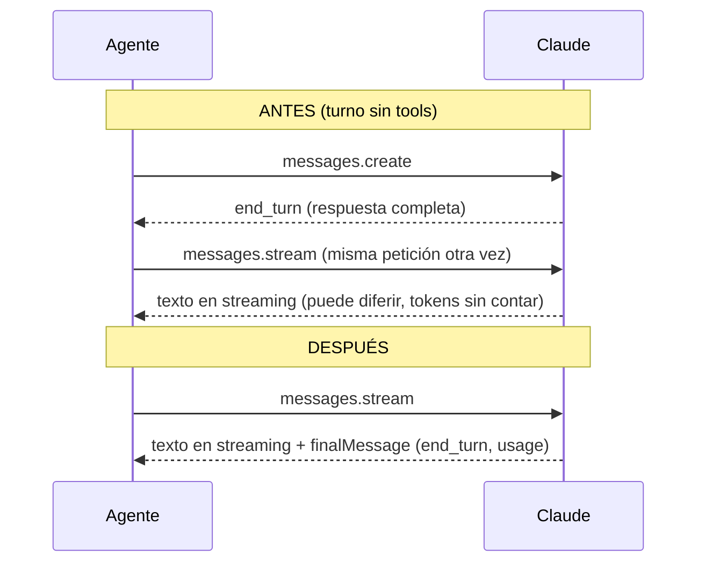

# 14 · Problemas conocidos

> **Propósito de esta sección:** registrar los bugs y la deuda técnica encontrados en el proyecto, cómo se resolvieron y qué queda pendiente.

## 🧭 Resumen

| Bloque | Cantidad | Estado |
|---|---|---|
| Bugs detectados al documentar (B1–B20) | 20 | ✅ Corregidos |
| Deuda técnica (D1–D17) | 17 | ✅ 16 resueltas · 🟡 1 parcial (D17: carpeta `DEV-ASSITANT`) |
| Pendiente / vigilancia | 3 | ⚠️ Ver [al final](#️-pendiente-y-limitaciones-aceptadas) |

Verificación: `npm run typecheck` (src + tests) y **`npm test` → 41/41 tests en verde**, sin llamar a APIs.

---

## ✅ Bugs corregidos (25-11-2026)

| # | Archivo | Problema | Corrección |
|---|---|---|---|
| B1 | `agent/tool-registry.ts` | `create_issue` guardaba el archivo **sin `.md`**, pero numeraba contando los `.md`: siempre calculaba `001` y **sobrescribía** el issue anterior | Nombre `issue-NNN.md` |
| B2 | `agent/tool-registry.ts` | La plantilla del issue tenía sangría dentro del template literal y salía como bloque de código | Líneas unidas con `join("\n")` |
| B3 | `agent/tool-registry.ts` | En `search_docs` el `]` cerraba después del contenido del chunk | `[FUENTE … %]\ncontenido` |
| B4 | `agent/tool-registry.ts` | Faltaban un espacio y un punto en el mensaje de "sin resultados" | Texto corregido |
| B5 | `tools/executor.ts` | `list_files` unía las rutas con `"\\n"` literal: el modelo recibía todo en una sola línea | `join("\n")` |
| B6 | `tools/executor.ts` | El aviso de truncado de `read_file` usaba `"\\n"` literal | `"\n\n… [archivo truncado]"` |
| B7 | `tools/executor.ts` | La cabecera de `search_code` se pegaba al primer resultado | `header + "\n\n" + …` |
| B8 | `tools/executor.ts` | Comillas mal cerradas en el mensaje de tool desconocida | Corregido |
| B9 | `security/guardrails.ts` | `sanitizeInput` borraba `\n`, `\r` y `\t` junto con los demás caracteres de control | Regex `/[\x00-\x08\x0B\x0C\x0E-\x1F\x7F]/g` |
| B10 | `rag/ingest.ts` | `embeddingDims` guardaba el vector entero en vez de su longitud | `.length` |
| B11 | `rag/ingest.ts` | Sin `.md` llamaba a OpenAI con una lista vacía y **vaciaba la base** | Retorno temprano (ahora en `indexer.ts`) |
| B12 | `rag/ingest.ts` | No cerraba la BD ni salía con código de error | `close()` + `exit(1)` |
| B13 | `llm/anthropic-client.ts` | Lanzaba `ErrorEvent` (API del navegador) | `Error` |
| B14 | `config.ts` | Import con extensión `.ts` en lugar de `.js` | `./interface.js` |
| B15 | `config.ts` | Erratas en mensajes de error | Corregidas |
| B16 | `config.ts` + `index.ts` | `validateConfig()` nunca se llamaba | Se llama al arrancar; exige `ANTHROPIC_API_KEY` y avisa si falta `OPENAI_API_KEY` |
| B17 | `utils/cost-calculator.ts` | `claude-haiku-4-5-20251001` (sugerido en `.env.template`) no tenía precio | Alias añadido |
| B18 | `chat/cli.ts` | Errata "DevAssitantAgent:" | "DevAssistant:" |
| B19 | `rag/rag-chain.ts` | Errata "en le vector store" | "en el" |
| B20 | `.github/codespaces/post-create.sh` | Decía "5 escenarios" (son 4) | 4 |

---

## ✅ Deuda técnica resuelta (25-11-2026)

| # | Área | Problema original | Solución aplicada | Cubierto por test |
|---|---|---|---|---|
| D1 | `agent/agent.ts` | Con streaming hacía **una 2ª llamada** a la API al final de cada turno; el texto mostrado podía diferir y sus tokens no se contaban | Nuevo método privado `callModel()`: **cada iteración del loop** usa `messages.stream` (si hay `onChunk`) y `finalMessage()` para leer `stop_reason` y `usage`. Una sola llamada por iteración y todos los tokens contados | — (requiere API) |
| D2 | `chat/cli.ts`, `rag/ingest.ts` | Ingesta duplicada; importar `ingest.ts` ejecutaba la ingesta | Nuevo módulo **`rag/indexer.ts`** (`indexDocuments`) usado por la CLI y por el script. `ingest.ts` solo se ejecuta si es el módulo principal | Verificado manualmente |
| D3 | `config.ts`, `interface.ts`, `types.ts` | `MODEL_PROVIDER` y `OPENAI_MODEL` sin efecto | **Eliminados** (decisión: Claude para el chat, OpenAI solo para embeddings). También se quitaron `ModelProvider` y `validateProvider` | typecheck |
| D4 | `agent/tool-registry.ts` | Número de issue = cantidad de `.md` + 1: al borrar uno intermedio se sobrescribía el último | `nextIssueNumber()` = **máximo `issue-NNN` existente + 1**, y escritura con flag **`wx`** (falla en vez de sobrescribir) | `tools.test.ts` |
| D5 | `rag/chunker.ts` | Ingesta no recursiva; el id usaba solo el nombre del archivo | `processDirectory` recorre **subcarpetas** (omite ocultas y `node_modules`); `source` e `id` usan la **ruta relativa** (`guias/README.md-0`) | `chunker.test.ts` |
| D6 | `rag/embeddings.ts` | Una sola petición para todos los textos | **Lotes de 100** textos, ordenados por `index` | — (requiere API) |
| D7 | `rag/vector-store.ts`, `config.ts` | Dimensión `float[1536]` fija | La dimensión sale de `config.embeddingDimensions` (deducida del modelo o `EMBEDDING_DIMENSIONS`) y se **guarda en una tabla `meta`**. `clear()` recrea la tabla con la dimensión actual; los vectores de otra dimensión dan un error claro. Las bases antiguas se reconocen como 1536 | `vector-store.test.ts` |
| D8 | `agent/agent.ts`, `cli.ts` | Semántica confusa de `clearHistory()` y `getStats()` | Documentada en el código: **tokens = sesión completa**, **turnos = conversación actual**. `/clear` lo indica al usuario | — |
| D9 | `interface.ts` | `ToolResult` sin uso | Eliminado | typecheck |
| D10 | `tools/executor.ts` | `read_file` podía leer `.env`; el sandbox no resolvía symlinks | `resolveSecurePath` usa **`realpath`** (un symlink que apunte fuera se rechaza) e `isSecretFile` bloquea `.env`, `.env.local`… (permite `.env.template/.example/.sample`) | `tools.test.ts` |
| D11 | `security/guardrails.ts` | "actúa como" bloqueaba peticiones legítimas | La regla solo dispara con un **rol de jailbreak** (sin restricciones/límites/filtros/reglas, DAN, jailbreak, hacker, malicioso, otra IA/asistente/modelo/personaje). Se mantiene "actúa como si fueras…" | `guardrails.test.ts` |
| D12 | Codespaces | `devcontainer.json` vacío y en una ruta que no se lee | Nuevo **`.devcontainer/devcontainer.json`** (imagen Node 22, `postCreateCommand`, secrets declarados); se borró el archivo vacío | — |
| D13 | `package.json` | Dependencia `readline` innecesaria | `npm uninstall readline` | — |
| D14 | General | Sin tests | **`npm test`** (`node:test` + `tsx`, sin dependencias nuevas): 41 tests en `tests/`. `npm run typecheck` también comprueba los tests | ✅ |
| D15 | `chat/cli.ts` | Bucle recursivo con callbacks | `for await (const line of rl)` con `handleInput()`; las líneas se procesan de una en una | Verificado con entrada por tubería |
| D16 | `utils/cost-calculator.ts`, `cli.ts` | `/stats` no incluía embeddings | `getEmbeddingTokensUsed()` en `embeddings.ts`; `/stats` y `/exit` muestran el costo de chat + embeddings. `formatUSD` exportado | `cost-calculator.test.ts` |
| D17 | Nombres | Erratas en identificadores | `executeCreateIssue`, `iteration`, `loadDotenv`, `targetPath`. 🟡 La carpeta `DEV-ASSITANT` **no** se renombró: rompería rutas externas (memoria de Claude Code, accesos directos) | typecheck |

### Antes y después de D1 (streaming del agente)



---

## ⚠️ Pendiente y limitaciones aceptadas

| Tema | Detalle | Por qué no se cambia ahora |
|---|---|---|
| Carpeta `DEV-ASSITANT` | Errata en el nombre de la carpeta raíz | Renombrarla rompe rutas fuera del repositorio; hazlo manualmente cuando convenga |
| Precios de `PRICING` | Están fijos en el código ("precios a mayo 2026") | Revísalos cuando cambie la tarifa o uses otro modelo |
| Guardrails por regex | Se pueden evitar con sinónimos u otros idiomas; la injection indirecta (en docs o archivos leídos) no se detecta | Es una primera barrera; las tools son casi solo de lectura (ver [13](13-seguridad.md)) |
| Texto previo a las tools | Con streaming real, si Claude escribe algo antes de pedir una tool ("Voy a buscar…") se muestra en la terminal | Es el comportamiento esperado de un agente en streaming |

## 🧪 Cómo verificar después de tocar el código

```bash
npm run typecheck                       # tsc sobre src/ y tests/
npm test                                # 41 tests, sin APIs
npx tsx src/security/examples.ts        # demo de guardrails (gratis)
npm run review ./src/config.ts          # Claude end-to-end (con costo)
npm run ingest                          # OpenAI + SQLite (con costo)
npm run demo                            # agente completo (con costo, crea un issue)
```
