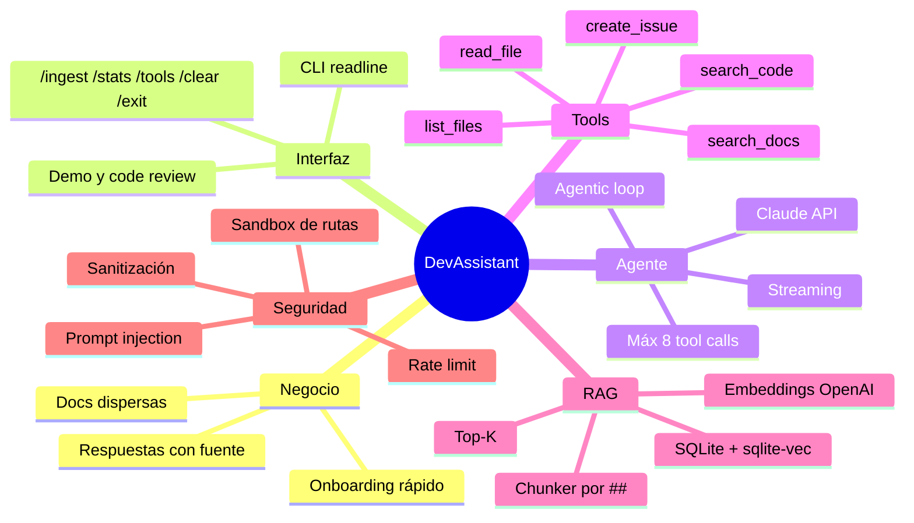

# 📘 DevAssistant — Documentación completa del proyecto

> 🖥️ **Versión interactiva:** abre [`index.html`](index.html) en el navegador (doble clic) para ver esta misma documentación con navegación lateral y diagramas renderizados.

> **DevAssistant** es una **CLI conversacional** escrita en TypeScript que funciona como asistente técnico para desarrolladores. Combina tres técnicas:
> 1. **Claude (Anthropic)** como cerebro del agente.
> 2. **RAG** (Retrieval-Augmented Generation): indexa documentación Markdown en una base vectorial local (SQLite + `sqlite-vec`) usando **embeddings de OpenAI** y responde citando la fuente.
> 3. **Function calling** (tool use): el modelo puede listar, leer y buscar archivos del proyecto, buscar en la documentación y crear issues en disco.

Esta carpeta está pensada para que **cualquier persona (incluido tú en el futuro) entienda el proyecto completo sin leer el código primero**: qué hace, por qué, cómo está construido, para qué sirve cada archivo, cómo se usa y qué partes se pueden reutilizar.

---

## 🧭 ¿Por dónde empiezo?

| Si quieres… | Lee |
|---|---|
| Entender **qué es** y **para qué sirve** en 5 minutos | [01 Visión](01-vision-negocio.md) → [02 Idea](02-idea-asistente.md) |
| **Usarlo** ya mismo | [11 Guía de uso](11-guia-de-uso.md) → [07 Configuración](07-configuracion.md) |
| Entender **cómo está construido** | [03 Arquitectura](03-arquitectura.md) → [04 Flujos](04-flujos.md) → [05 Modelo de datos](05-modelo-datos.md) |
| Saber **qué hace cada archivo** | [09 Catálogo de archivos](09-catalogo-archivos.md) |
| **Modificarlo / añadir una tool** | [06 Funciones y tools](06-funciones-tools.md) → [09 Catálogo](09-catalogo-archivos.md) |
| **Copiar piezas** a otro proyecto | [12 Reutilizables](12-reutilizables.md) |
| Revisar **bugs y deuda técnica** | [14 Problemas conocidos](14-problemas-conocidos.md) |
| Un término que no conoces | [15 Glosario](15-glosario.md) |

## 🗺️ Mapa del proyecto



## 📑 Índice

| # | Documento | Responde a |
|---|---|---|
| 01 | [Visión de negocio](01-vision-negocio.md) | ¿Qué problema resuelve, para quién y cómo medir el éxito? |
| 02 | [Idea del asistente](02-idea-asistente.md) | ¿Qué hace el asistente, cómo se comporta y qué no hace? |
| 03 | [Arquitectura](03-arquitectura.md) | ¿Cuáles son las piezas, capas y dependencias? |
| 04 | [Flujos](04-flujos.md) | ¿Qué pasa paso a paso en cada operación? (diagramas de secuencia) |
| 05 | [Modelo de datos](05-modelo-datos.md) | Interfaces, clases (UML) y esquema SQLite (ER) |
| 06 | [Funciones y tools](06-funciones-tools.md) | Las 5 tools del agente, su esquema y cómo añadir una nueva |
| 07 | [Configuración](07-configuracion.md) | Variables de entorno, comandos npm, comandos de la CLI, Codespaces |
| 08 | [Roadmap](08-roadmap.md) | ¿Qué está hecho y qué falta? |
| 09 | [Catálogo de archivos](09-catalogo-archivos.md) | **Ficha de cada archivo**: propósito, exports, dependencias, uso |
| 10 | [Casos de uso](10-casos-de-uso.md) | Diagrama UML de casos de uso y especificación de cada uno |
| 11 | [Guía de uso](11-guia-de-uso.md) | Tutorial paso a paso y solución de problemas |
| 12 | [Reutilizables](12-reutilizables.md) | Qué módulos copiar a otros proyectos y cómo |
| 13 | [Seguridad](13-seguridad.md) | Guardrails, sandbox de rutas y límites |
| 14 | [Problemas conocidos](14-problemas-conocidos.md) | Bugs corregidos, deuda técnica resuelta y lo que queda pendiente |
| 15 | [Glosario](15-glosario.md) | Términos: RAG, embedding, chunk, tool use… |

## 🏷️ Leyenda de estados

| Marca | Significado |
|---|---|
| ✅ Implementado | Existe y funciona en el código actual (`src/`) |
| 🟡 Planeado | Idea o diseño, aún sin código |
| ⚠️ Atención | Inconsistencia, limitación o deuda técnica a tener en cuenta |

## 📦 Resumen técnico en una tabla

| Aspecto | Valor |
|---|---|
| Lenguaje | TypeScript 5 (strict, ESM, `NodeNext`) ejecutado con `tsx` |
| LLM del agente | Claude vía `@anthropic-ai/sdk` (modelo en `ANTHROPIC_MODEL`, por defecto `claude-sonnet-4-6`) |
| Embeddings | OpenAI `text-embedding-3-small` (1536 dimensiones) vía `openai` |
| Base vectorial | SQLite (`better-sqlite3`) + extensión `sqlite-vec` en `data/vectors.db` |
| Interfaz | CLI interactiva (`readline`) |
| Corpus de ejemplo | Docs ficticias de **TaskFlow API** en [`../sample-project/`](../sample-project/) (3 archivos → 30 chunks) |
| Código fuente | 27 archivos `.ts` en `src/`, ~2.600 líneas |
| Tests | `npm test`: 41 tests (`node:test` + `tsx`) en `tests/`, sin llamar a APIs. `npm run typecheck` revisa `src/` y `tests/`. No hay linter |

Diagramas de referencia del curso (imágenes): [`../config-model/`](../config-model/).

---

## ♻️ Cómo reutilizar esta documentación como plantilla

1. Copia `docs/proyecto/` al nuevo repositorio.
2. Recorre los archivos en orden (01 → 15). Los documentos 01–08 terminan con un bloque **📝 Plantilla** con las preguntas que debes responder.
3. Mantén los títulos de sección y el tipo de diagrama; reemplaza el contenido.
4. El [catálogo de archivos](09-catalogo-archivos.md) usa una ficha fija por archivo: cópiala tal cual.
5. Mantén la leyenda ✅/🟡/⚠️ para distinguir lo construido de lo planeado.

## 🔄 Mantener `index.html` al día

Los `.md` son la **fuente de verdad**. `index.html` se genera a partir de ellos (los incrusta y los renderiza con marked + mermaid desde CDN):

```bash
node docs/proyecto/build-index.mjs
```

Ejecútalo cada vez que edites un `.md` de esta carpeta. Para ver el HTML basta con hacer doble clic (necesita conexión a internet para cargar las librerías).

> Los diagramas usan **Mermaid**: se renderizan en GitHub, GitLab, VS Code (extensión *Markdown Preview Mermaid Support*) y en `index.html`. Editor online: https://mermaid.live
